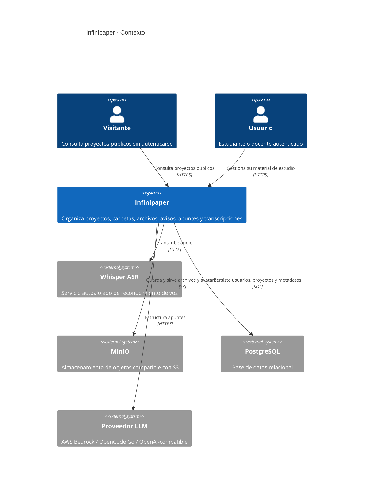
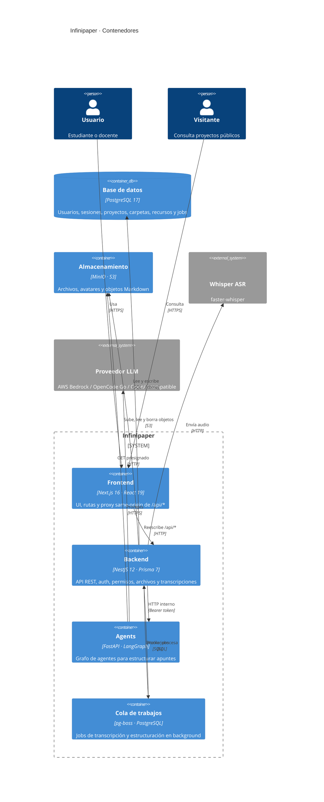
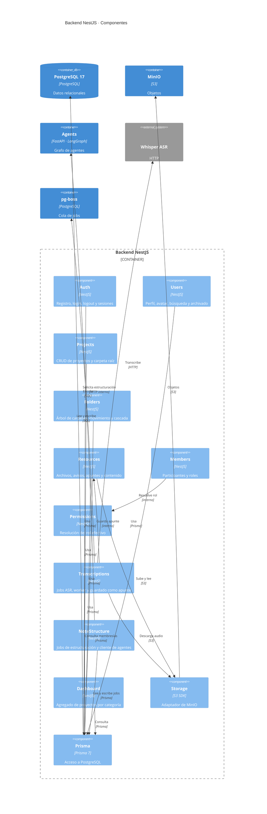
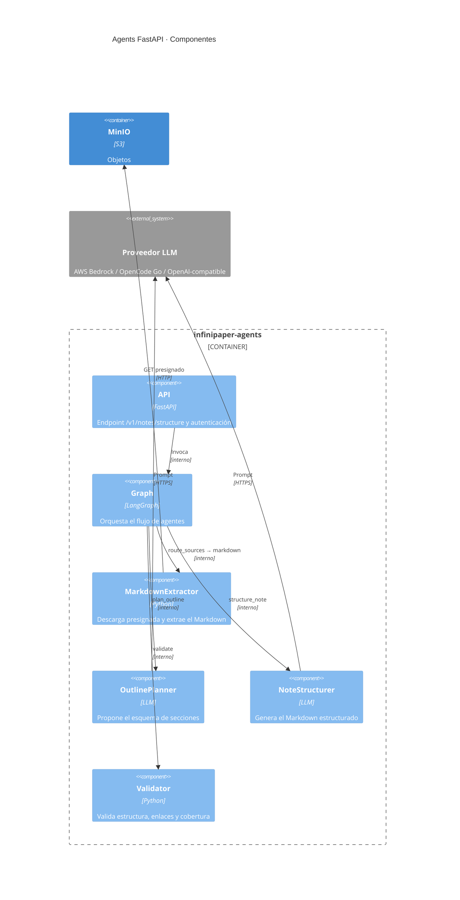

# Arquitectura C4

Vistas C4 de Infinipaper: contexto, contenedores y componentes del backend. El detalle de despliegue y variables está en [`referencia/infraestructura.md`](../referencia/infraestructura.md).

## Nivel 1 · Contexto

## Nivel 2 · Contenedores

## Nivel 3 · Componentes del backend

## Nivel 3 · Componentes del servicio de agentes

## Decisiones representadas

| Vista | Decisión |
|---|---|
| Contexto | El sistema no se integra con servicios de terceros más allá de MinIO y Whisper |
| Contenedores | Un único backend NestJS; sin microservicios |
| Contenedores | La cola vive en PostgreSQL (`pg-boss`), sin Redis |
| Componentes | `PermissionsService` centraliza la autorización |
| Componentes | `ResourcesService` reutiliza MinIO para archivos, avisos y apuntes |
| Componentes | Las transcripciones reutilizan `ResourcesService` para guardar el apunte |
| Componentes | `NoteStructure` delega la estructuración en el servicio de agentes |
| Agentes | LangGraph orquesta router, extractor, planner, structurer y validator |
| Agentes | v1 solo procesa Markdown; el contrato admite múltiples fuentes |
