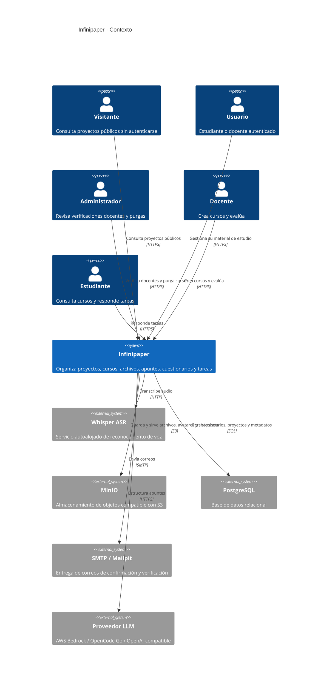
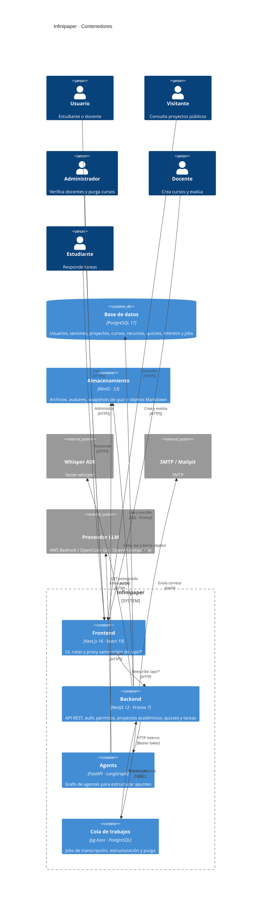
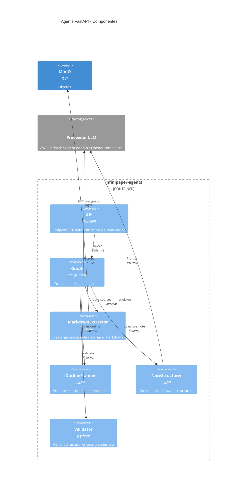

# Arquitectura C4

Vistas C4 de Infinipaper: contexto, contenedores y componentes del backend. El detalle de variables está en [`referencia/infraestructura.md`](../referencia/infraestructura.md) y el despliegue concreto de la demo en [`despliegue.md`](./despliegue.md).

## Nivel 1 · Contexto

## Nivel 2 · Contenedores

## Nivel 3 · Componentes del backend

```mermaid
C4Component
  title Backend NestJS · Componentes

  Container_Boundary(api, "Backend NestJS") {
    Component(auth, "Auth", "NestJS", "Registro, login, logout, sesiones y confirmación de email")
    Component(email, "Email", "Nodemailer", "Envío SMTP de confirmaciones y decisiones docentes")
    Component(teacher, "Teacher", "NestJS", "Perfil docente, verificación y auditoría")
    Component(users, "Users", "NestJS", "Perfil, avatar, búsqueda y archivado")
    Component(projects, "Projects", "NestJS", "CRUD de proyectos, cursos, archivado y purga")
    Component(folders, "Folders", "NestJS", "Árbol de carpetas, movimiento y cascada")
    Component(resources, "Resources", "NestJS", "Archivos, avisos, apuntes, cuestionarios y contenido")
    Component(members, "Members", "NestJS", "Participantes y roles, incluido Student")
    Component(permissions, "Permissions", "NestJS", "Resolución del rol efectivo y bloqueo de archivados")
    Component(quizzes, "Quizzes", "NestJS", "Cuestionarios, preguntas y snapshots")
    Component(quizAssignments, "QuizAssignments", "NestJS", "Tareas, intentos, calificación y resultados")
    Component(transcriptions, "Transcriptions", "NestJS", "Jobs ASR, worker y guardado como apunte")
    Component(noteStructure, "NoteStructure", "NestJS", "Jobs de estructuración y cliente de agentes")
    Component(dashboard, "Dashboard", "NestJS", "Agregado de proyectos por categoría")
    Component(analytics, "Analytics", "NestJS", "Panel docente, riesgo y progreso personal")
    Component(provenance, "Provenance", "NestJS", "Origen, fuentes y validación de recursos")
    Component(contentGeneration, "ContentGeneration", "NestJS", "Jobs de mapas mentales y quiz IA")
    Component(usage, "Usage", "NestJS", "Eventos y agregados de uso de recursos")
    Component(search, "Search", "NestJS", "Chunks, embeddings y búsqueda híbrida")
    Component(mcp, "MCP", "NestJS", "Tokens y API de solo lectura para MCP")
    Component(storage, "Storage", "S3 SDK", "Adaptador de MinIO")
    Component(prisma, "Prisma", "Prisma 7", "Acceso a PostgreSQL")
  }

  ContainerDb(db, "PostgreSQL 17", "PostgreSQL", "Datos relacionales")
  Container(minio, "MinIO", "S3", "Objetos")
  Container(agents, "Agents", "FastAPI · LangGraph", "Grafo de agentes")
  System_Ext(whisper, "Whisper ASR", "HTTP", "Transcripción")
  System_Ext(mailpit, "SMTP / Mailpit", "SMTP", "Correos")
  Container(queue, "pg-boss", "PostgreSQL", "Cola de jobs")

  Rel(auth, prisma, "Usa", "Prisma")
  Rel(auth, email, "Solicita correo", "interno")
  Rel(teacher, prisma, "Usa", "Prisma")
  Rel(teacher, email, "Notifica decisión", "interno")
  Rel(users, prisma, "Usa", "Prisma")
  Rel(projects, prisma, "Usa", "Prisma")
  Rel(projects, queue, "Programa purga", "SQL")
  Rel(folders, prisma, "Usa", "Prisma")
  Rel(resources, prisma, "Usa", "Prisma")
  Rel(resources, storage, "Sube y lee", "S3")
  Rel(resources, permissions, "Filtra quizzes", "interno")
  Rel(members, permissions, "Resuelve rol", "interno")
  Rel(permissions, prisma, "Consulta membresías", "Prisma")
  Rel(quizzes, prisma, "Usa", "Prisma")
  Rel(quizzes, storage, "Guarda snapshot", "S3")
  Rel(quizzes, permissions, "Autoriza", "interno")
  Rel(quizAssignments, prisma, "Usa", "Prisma")
  Rel(quizAssignments, permissions, "Autoriza", "interno")
  Rel(transcriptions, queue, "Encola", "SQL")
  Rel(transcriptions, storage, "Descarga audio", "S3")
  Rel(transcriptions, whisper, "Transcribe", "HTTP")
  Rel(transcriptions, resources, "Guarda apunte", "interno")
  Rel(noteStructure, prisma, "Lee y escribe jobs", "Prisma")
  Rel(noteStructure, agents, "Solicita estructuración", "HTTP interno")
  Rel(dashboard, prisma, "Consulta", "Prisma")
  Rel(analytics, prisma, "Agrega", "Prisma")
  Rel(analytics, permissions, "Autoriza", "interno")
  Rel(provenance, prisma, "Lee y valida", "Prisma")
  Rel(provenance, permissions, "Autoriza", "interno")
  Rel(contentGeneration, prisma, "Jobs", "Prisma")
  Rel(contentGeneration, queue, "Encola", "SQL")
  Rel(contentGeneration, agents, "Genera contenido", "HTTP interno")
  Rel(contentGeneration, resources, "Guarda recurso", "interno")
  Rel(usage, prisma, "Eventos y agregados", "Prisma")
  Rel(search, prisma, "Chunks y búsqueda", "Prisma")
  Rel(search, prisma, "pgvector", "SQL")
  Rel(mcp, prisma, "Tokens y resultados", "Prisma")
  Rel(search, usage, "Registra SEARCH_HIT", "interno")
  Rel(email, mailpit, "SMTP", "SMTP")
  Rel(prisma, db, "Lee y escribe", "SQL")
  Rel(storage, minio, "Objetos", "S3")

  UpdateLayoutConfig($c4ShapeInRow="3", $c4BoundaryInRow="2")
```

## Nivel 3 · Componentes del servicio de agentes

## Decisiones representadas

| Vista | Decisión |
|---|---|
| Contexto | El sistema no se integra con servicios de terceros más allá de MinIO, Whisper, SMTP y el proveedor LLM |
| Contenedores | Un único backend NestJS; sin microservicios |
| Contenedores | La cola vive en PostgreSQL (`pg-boss`), sin Redis |
| Contenedores | Mailpit sustituye al SMTP real en desarrollo |
| Componentes | `PermissionsService` centraliza la autorización de proyecto y bloquea escrituras archivadas |
| Componentes | `RolesGuard` centraliza los roles globales `ADMIN`, `TEACHER` y `STUDENT` |
| Componentes | `ResourcesService` reutiliza MinIO para archivos, avisos, apuntes y snapshots de quiz |
| Componentes | `QuizzesService` mantiene preguntas relacionales y un snapshot JSON |
| Componentes | `QuizAssignmentsService` gestiona tareas, intentos, calificación y resultados |
| Componentes | `TeacherService` gestiona verificación docente y auditoría |
| Componentes | `AnalyticsService` agrega métricas solo para docentes/editores |
| Componentes | `ProvenanceService` valida recursos y conserva fuentes |
| Componentes | `ContentGenerationService` usa agentes para mapas y quizzes IA |
| Componentes | `UsageService` registra eventos servidor sin contenido |
| Componentes | `SearchService` usa pgvector y fallback léxico |
| Componentes | `McpService` valida tokens y alimenta FastMCP |
| Agentes | LangGraph orquesta router, extractor, planner, structurer y validator |
| Agentes | v1 solo procesa Markdown; el contrato admite múltiples fuentes |
