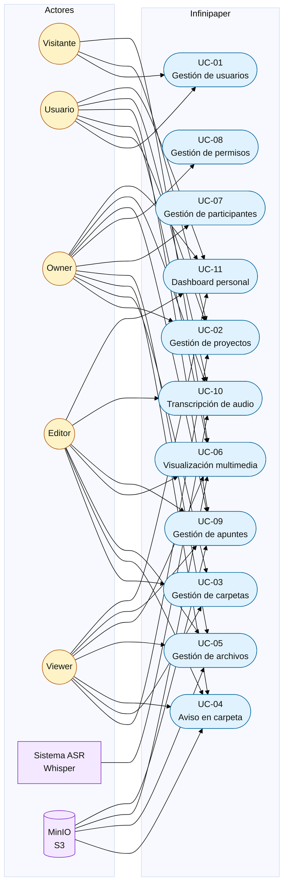

# Casos de uso

Cada caso de uso corresponde a una spec. Los actores `Owner`, `Editor` y `Viewer` son roles dentro de un proyecto; heredan las capacidades de `Usuario` y añaden o restringen acciones según la matriz de permisos de la [spec 008](../specs/008-permisos/spec.md).

## Trazabilidad

| Caso de uso | Spec | Actores principales |
|---|---|---|
| UC-01 Gestión de usuarios | [001](../specs/001-usuarios/spec.md) | Visitante, Usuario |
| UC-02 Gestión de proyectos | [002](../specs/002-proyectos/spec.md) | Visitante, Usuario, Owner |
| UC-03 Gestión de carpetas | [003](../specs/003-carpetas/spec.md) | Owner, Editor, Viewer |
| UC-04 Aviso en carpeta | [004](../specs/004-aviso/spec.md) | Owner, Editor, Viewer, MinIO |
| UC-05 Gestión de archivos | [005](../specs/005-archivos/spec.md) | Owner, Editor, Viewer, MinIO |
| UC-06 Visualización multimedia | [006](../specs/006-visualizacion/spec.md) | Visitante, Usuario, Viewer, MinIO |
| UC-07 Gestión de participantes | [007](../specs/007-participantes/spec.md) | Owner |
| UC-08 Gestión de permisos | [008](../specs/008-permisos/spec.md) | Owner |
| UC-09 Gestión de apuntes | [009](../specs/009-apuntes/spec.md) | Owner, Editor, Viewer, MinIO |
| UC-10 Transcripción de audio | [010](../specs/010-transcripcion/spec.md) | Usuario, Editor, Owner, Whisper |
| UC-11 Dashboard personal | [011](../specs/011-dashboard/spec.md) | Usuario, Owner, Editor, Viewer |

> `Visitante` solo accede a proyectos públicos en modo lectura y a las pantallas de registro/login. Las acciones de escritura requieren un rol de proyecto.
