# Casos de uso

Cada caso de uso corresponde a una spec. Los actores `Owner`, `Editor`, `Viewer` y `Student` son roles dentro de un proyecto; heredan las capacidades de `Usuario` y añaden o restringen acciones según la matriz de permisos de la [spec 008](../specs/008-permisos/spec.md). Los roles globales `ADMIN`, `TEACHER` y `STUDENT` se representan con los actores `Administrador`, `Docente` y `Estudiante`.

Este diagrama general incluye únicamente actores humanos. Los sistemas externos (`Whisper`, `MinIO`, `Mailpit`, `LLM` y clientes MCP) no se representan aquí como actores; aparecen en los diagramas C4 y de secuencia.

> Las specs 013 (sistema de diseño) y 014 (tema de marca) son transversales de producto y no añaden un caso de uso funcional. Por eso la numeración de casos de uso salta de `UC-12` a `UC-15`.

```mermaid
%%{init: {"theme": "base", "themeVariables": {"fontFamily": "Inter, sans-serif"}}}%%
flowchart LR
  classDef actor fill:#fef3c7,stroke:#b45309,stroke-width:1px,color:#111
  classDef usecase fill:#e0f2fe,stroke:#0369a1,stroke-width:1px,color:#111

  subgraph Actores["Actores humanos"]
    Visitante((Visitante)):::actor
    Usuario((Usuario)):::actor
    Owner((Owner)):::actor
    Editor((Editor)):::actor
    Viewer((Viewer)):::actor
    Administrador((Administrador)):::actor
    Docente((Docente)):::actor
    Estudiante((Estudiante)):::actor
  end

  subgraph Sistema["Infinipaper"]
    UC01([UC-01<br/>Gestión de usuarios]):::usecase
    UC02([UC-02<br/>Gestión de proyectos]):::usecase
    UC03([UC-03<br/>Gestión de carpetas]):::usecase
    UC04([UC-04<br/>Aviso en carpeta]):::usecase
    UC05([UC-05<br/>Gestión de archivos]):::usecase
    UC06([UC-06<br/>Visualización multimedia]):::usecase
    UC07([UC-07<br/>Gestión de participantes]):::usecase
    UC08([UC-08<br/>Gestión de permisos]):::usecase
    UC09([UC-09<br/>Gestión de apuntes]):::usecase
    UC10([UC-10<br/>Transcripción de audio]):::usecase
    UC11([UC-11<br/>Dashboard personal]):::usecase
    UC12([UC-12<br/>Estructuración de apuntes con IA]):::usecase
    UC15([UC-15<br/>Perfil docente y verificación]):::usecase
    UC16([UC-16<br/>Proyectos académicos y archivado]):::usecase
    UC17([UC-17<br/>Cuestionarios como recursos]):::usecase
    UC18([UC-18<br/>Tareas, intentos y revisión]):::usecase
    UC19([UC-19<br/>Panel docente y progreso]):::usecase
    UC20([UC-20<br/>Trazabilidad y validación]):::usecase
    UC21([UC-21<br/>Mapas mentales con IA]):::usecase
    UC22([UC-22<br/>Cuestionarios con IA]):::usecase
    UC23([UC-23<br/>Métricas de uso]):::usecase
    UC24([UC-24<br/>Búsqueda semántica]):::usecase
    UC25([UC-25<br/>MCP de desempeño]):::usecase
    UC26([UC-26<br/>App móvil]):::usecase
  end

  Visitante --> UC01
  Visitante --> UC02
  Visitante --> UC06

  Usuario --> UC01
  Usuario --> UC02
  Usuario --> UC06
  Usuario --> UC09
  Usuario --> UC10
  Usuario --> UC11

  Owner --> UC02
  Owner --> UC03
  Owner --> UC04
  Owner --> UC05
  Owner --> UC07
  Owner --> UC08
  Owner --> UC09
  Owner --> UC10
  Owner --> UC11
  Owner --> UC12

  Editor --> UC03
  Editor --> UC04
  Editor --> UC05
  Editor --> UC06
  Editor --> UC09
  Editor --> UC10
  Editor --> UC11
  Editor --> UC12

  Viewer --> UC02
  Viewer --> UC03
  Viewer --> UC04
  Viewer --> UC05
  Viewer --> UC06
  Viewer --> UC09
  Viewer --> UC11

  Usuario --> UC15
  Administrador --> UC01
  Docente --> UC01
  Estudiante --> UC01
  Administrador --> UC08
  Docente --> UC08
  Estudiante --> UC08
  Administrador --> UC15
  Administrador --> UC16
  Docente --> UC15
  Docente --> UC16
  Docente --> UC17
  Docente --> UC18
  Owner --> UC16
  Owner --> UC17
  Owner --> UC18
  Editor --> UC16
  Editor --> UC17
  Editor --> UC18
  Estudiante --> UC16
  Estudiante --> UC17
  Estudiante --> UC18
  Viewer --> UC16
  Viewer --> UC17
  Owner --> UC19
  Editor --> UC19
  Docente --> UC19
  Estudiante --> UC19
  Owner --> UC20
  Editor --> UC20
  Docente --> UC20
  Viewer --> UC20
  Estudiante --> UC20
  Owner --> UC21
  Editor --> UC21
  Docente --> UC21
  Owner --> UC22
  Editor --> UC22
  Docente --> UC22
  Owner --> UC23
  Editor --> UC23
  Docente --> UC23
  Usuario --> UC24
  Viewer --> UC24
  Estudiante --> UC24
  Owner --> UC25
  Editor --> UC25
  Docente --> UC25
  Usuario --> UC26
  Docente --> UC26
  Estudiante --> UC26
  Administrador --> UC26
```

## Trazabilidad

| Caso de uso | Spec | Actores principales |
|---|---|---|
| UC-01 Gestión de usuarios | [001](../specs/001-usuarios/spec.md) | Visitante, Usuario, Administrador, Docente, Estudiante |
| UC-02 Gestión de proyectos | [002](../specs/002-proyectos/spec.md) | Visitante, Usuario, Owner |
| UC-03 Gestión de carpetas | [003](../specs/003-carpetas/spec.md) | Owner, Editor, Viewer |
| UC-04 Aviso en carpeta | [004](../specs/004-aviso/spec.md) | Owner, Editor, Viewer |
| UC-05 Gestión de archivos | [005](../specs/005-archivos/spec.md) | Owner, Editor, Viewer |
| UC-06 Visualización multimedia | [006](../specs/006-visualizacion/spec.md) | Visitante, Usuario, Viewer |
| UC-07 Gestión de participantes | [007](../specs/007-participantes/spec.md) | Owner |
| UC-08 Gestión de permisos | [008](../specs/008-permisos/spec.md) | Administrador, Docente, Owner, Editor, Viewer, Estudiante |
| UC-09 Gestión de apuntes | [009](../specs/009-apuntes/spec.md) | Owner, Editor, Viewer |
| UC-10 Transcripción de audio | [010](../specs/010-transcripcion/spec.md) | Usuario, Editor, Owner |
| UC-11 Dashboard personal | [011](../specs/011-dashboard/spec.md) | Usuario, Owner, Editor, Viewer |
| UC-12 Estructuración de apuntes con IA | [012](../specs/012-estructuracion-apuntes-ia/spec.md) | Owner, Editor |
| UC-15 Perfil docente y verificación | [015](../specs/015-perfil-docente/spec.md) | Usuario, Docente, Administrador |
| UC-16 Proyectos académicos y archivado | [016](../specs/016-proyectos-academicos/spec.md) | Docente, Owner, Editor, Viewer, Estudiante, Administrador |
| UC-17 Cuestionarios como recursos | [017](../specs/017-cuestionarios/spec.md) | Docente, Owner, Editor, Viewer, Estudiante |
| UC-18 Tareas, intentos y revisión | [018](../specs/018-tareas-intentos/spec.md) | Docente, Owner, Editor, Estudiante |
| UC-19 Panel docente y progreso | [019](../specs/019-panel-docente/spec.md) | Docente, Owner, Editor, Estudiante |
| UC-20 Trazabilidad y validación | [020](../specs/020-trazabilidad-recursos/spec.md) | Docente, Owner, Editor, Viewer, Estudiante |
| UC-21 Mapas mentales con IA | [021](../specs/021-mapas-mentales/spec.md) | Docente, Owner, Editor |
| UC-22 Cuestionarios con IA | [022](../specs/022-cuestionarios-ia/spec.md) | Docente, Owner, Editor |
| UC-23 Métricas de uso | [023](../specs/023-metricas-recursos/spec.md) | Docente, Owner, Editor |
| UC-24 Búsqueda semántica | [024](../specs/024-busqueda-semantica/spec.md) | Usuario, Viewer, Estudiante |
| UC-25 MCP de desempeño | [025](../specs/025-mcp-desempeno/spec.md) | Docente, Owner, Editor |
| UC-26 App móvil | [026](../specs/026-app-movil/spec.md) | Usuario, Docente, Estudiante, Administrador |

> `Visitante` solo accede a proyectos públicos en modo lectura y a las pantallas de registro/login. Las acciones de escritura requieren un rol de proyecto. Los roles globales `Administrador`, `Docente` y `Estudiante` no conceden acceso implícito a proyectos privados.

> Los sistemas externos (`Whisper`, `MinIO`, `Mailpit`, `LLM` y clientes MCP) se documentan en los diagramas C4 y de secuencia. No son actores del diagrama general de casos de uso.
