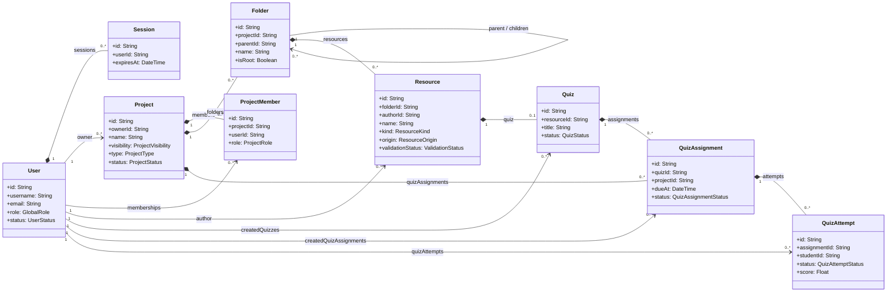
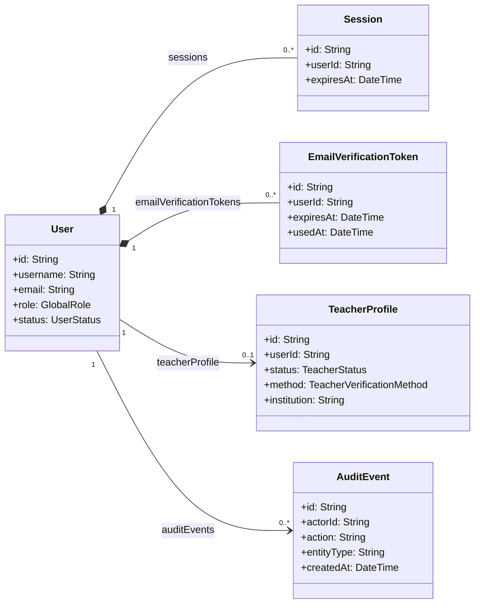
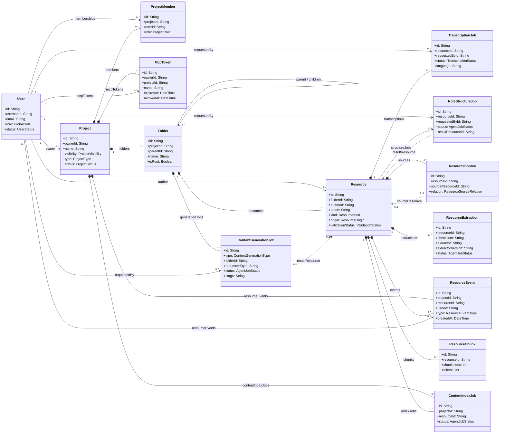
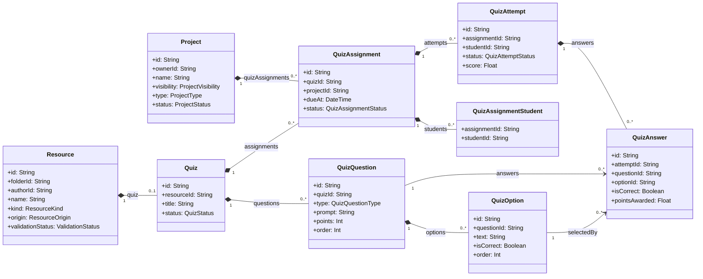
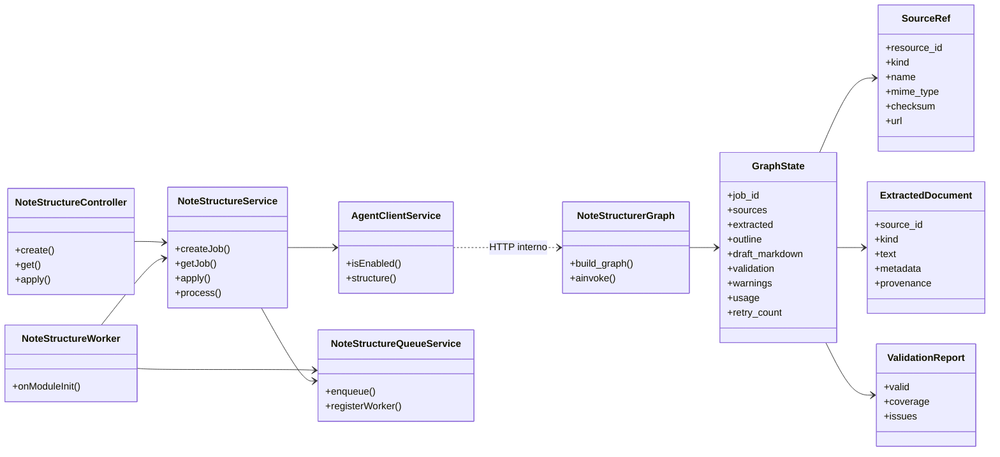

# Diseño de datos y clases de implementación

El diseño de datos se organiza en cuatro vistas legibles: una vista general y tres vistas por módulo. Las clases usan el formato UML de la referencia: nombre, atributos principales con `+nombre: Tipo`, asociaciones con etiqueta y multiplicidades, y dependencias discontinuas para referencias débiles.

> Esta vista lógica muestra los atributos principales; el detalle completo de columnas vive en [modelo.json](../ea/modelo.json). Los enums se documentan aparte y el modelo formal se mantiene en Enterprise Architect. Para EA existe un script independiente: [importar-diseno-datos.js](../ea/importar-diseno-datos.js).

## 1. Diseño de datos

### 1.1 Vista general

Entidades centrales de identidad, proyectos, recursos y evaluación.

### 1.2 Identidad y acceso

Usuarios, sesiones, confirmación de email, perfil docente y auditoría.

### 1.3 Proyectos y contenido

Proyectos, carpetas, recursos, extracciones, trabajos y trazabilidad.

### 1.4 Evaluación

Cuestionarios, preguntas, asignaciones, intentos y respuestas.

### 1.5 Enumeraciones

Los enums tipan atributos, pero no se dibujan como clases para mantener el diseño de datos legible.

| Enum | Valores |
|---|---|
| `UserStatus` | `ACTIVE`, `ARCHIVED` |
| `ProjectVisibility` | `PUBLIC`, `PRIVATE` |
| `ProjectRole` | `EDITOR`, `VIEWER`, `STUDENT` |
| `ResourceKind` | `DOCUMENT`, `IMAGE`, `AUDIO`, `VIDEO`, `MARKDOWN`, `QUIZ` |
| `TranscriptionStatus` | `QUEUED`, `PROCESSING`, `DONE`, `FAILED` |
| `AgentJobStatus` | `QUEUED`, `PROCESSING`, `DONE`, `FAILED` |
| `GlobalRole` | `ADMIN`, `TEACHER`, `STUDENT` |
| `TeacherStatus` | `PENDING`, `VERIFIED`, `REJECTED`, `REVOKED` |
| `TeacherVerificationMethod` | `INSTITUTIONAL_EMAIL`, `MANUAL` |
| `ProjectType` | `PERSONAL`, `COURSE` |
| `ProjectStatus` | `ACTIVE`, `ARCHIVED` |
| `QuizStatus` | `DRAFT`, `PUBLISHED`, `ARCHIVED` |
| `QuizQuestionType` | `MULTIPLE_CHOICE`, `TRUE_FALSE`, `SHORT_ANSWER` |
| `QuizAssignmentStatus` | `DRAFT`, `PUBLISHED`, `CLOSED` |
| `QuizAttemptStatus` | `IN_PROGRESS`, `SUBMITTED`, `GRADED`, `EXPIRED` |
| `ResourceOrigin` | `UPLOAD`, `NOTE`, `TRANSCRIPTION`, `AI_STRUCTURE`, `AI_MINDMAP`, `AI_QUIZ`, `QUIZ`, `IMPORT` |
| `ValidationStatus` | `UNVERIFIED`, `PENDING`, `VERIFIED`, `REJECTED` |
| `ResourceSourceRelation` | `DERIVED_FROM`, `CITES`, `USES` |
| `ContentGenerationType` | `MINDMAP`, `QUIZ` |
| `ResourceEventType` | `VIEW`, `DOWNLOAD`, `SEARCH_HIT`, `QUIZ_USE` |

### 1.6 Reglas del modelo

- `Project.ownerId` es la única fuente del rol **Owner**; el Owner no se guarda en `ProjectMember`.
- `ProjectMember.role` admite `EDITOR`, `VIEWER` y `STUDENT`; el rol `STUDENT` se resuelve como lectura en `PermissionsService`.
- `User.role` es el rol global (`ADMIN`, `TEACHER`, `STUDENT`); no concede acceso implícito a proyectos privados.
- `EmailVerificationToken.tokenHash` guarda el SHA-256 del token, nunca el token en claro.
- `Session.tokenHash` guarda el SHA-256 del token, nunca el token en claro.
- `Resource` representa archivos, avisos, apuntes y cuestionarios; no existen tablas `Note` ni `Notice`.
- Un `Quiz` siempre pertenece a un `Resource(kind=QUIZ)`; el snapshot JSON vive en MinIO y las preguntas viven en tablas.
- `Project` archivado bloquea escrituras a participantes que no son Owner; el Owner conserva la gestión.
- El borrado de `Project`, `Folder`, `Resource`, `Quiz` y `Session` es en cascada según Prisma.
- `Folder.parentId` es una auto-relación; la raíz tiene `isRoot = true`.
- `ContentGenerationJob.activeKey` es único mientras el job está activo y se libera al terminar.
- `ResourceExtraction` es única por `resourceId + checksum + extractorVersion`.
- `McpToken` está acotado a un proyecto y se revoca con `revokedAt`.

## 2. Clases de implementación del backend

> Esta sección es una referencia de lectura. **No se importa a Enterprise Architect**; el diseño de datos se importa con `importar-diseno-datos.js` y el modelo físico completo con `importar-modelo.js`.

```mermaid
classDiagram
  direction LR

  class AuthController {
    +register()
    +login()
    +logout()
    +me()
  }
  class AuthService {
    +register()
    +login()
    +logout()
    +requestEmailVerification()
    +confirmEmail()
  }
  class EmailService {
    +sendVerificationEmail()
    +sendTeacherDecision()
  }
  class TeacherService {
    +request()
    +approve()
    +reject()
    +revoke()
  }
  class AnalyticsService {
    +getPanel()
    +getTasks()
    +getStudents()
    +exportCsv()
    +myProgress()
  }
  class ProvenanceService {
    +get()
    +validate()
    +addSources()
    +setOrigin()
  }
  class ContentGenerationService {
    +createMindmap()
    +createQuiz()
    +getJob()
    +retry()
    +process()
  }
  class SearchIndexQueueService {
    +enqueue()
    +registerWorker()
  }
  class ContentGenerationQueueService {
    +enqueue()
    +registerWorker()
  }
  class ContentAgentClient {
    +generate()
  }
  class UsageService {
    +record()
    +getProjectUsage()
    +getFileUsage()
    +exportCsv()
    +purgeExpired()
  }
  class EmbeddingsService {
    +embed()
    +vectorLiteral()
  }
  class SearchService {
    +enqueueResource()
    +reindexProject()
    +status()
    +search()
    +process()
  }
  class McpService {
    +createToken()
    +listTokens()
    +revokeToken()
    +authorize()
    +listProjects()
    +projectSummary()
    +listTasks()
    +taskResults()
    +studentPerformance()
  }
  class RolesGuard {
    +canActivate()
  }
  class SessionService {
    +create()
    +validate()
    +revoke()
  }
  class PasswordService {
    +hash()
    +verify()
  }
  class UsersController {
    +search()
    +profile()
    +updateMe()
    +changePassword()
    +uploadAvatar()
    +archive()
  }
  class UsersService {
    +search()
    +updateProfile()
    +changePassword()
    +uploadAvatar()
    +archive()
  }
  class ProjectsController {
    +create()
    +list()
    +getOne()
    +update()
    +remove()
  }
  class ProjectsService {
    +create()
    +list()
    +getOne()
    +update()
    +archive()
    +extendArchive()
    +restore()
    +purgeExpired()
    +remove()
  }
  class ProjectPurgeQueueService {
    +onModuleInit()
    +onModuleDestroy()
  }
  class FoldersController {
    +tree()
    +create()
    +rename()
    +move()
    +remove()
  }
  class FoldersService {
    +tree()
    +create()
    +rename()
    +move()
    +remove()
  }
  class ResourcesController {
    +list()
    +upload()
    +createNote()
    +createNotice()
    +content()
    +updateContent()
    +rename()
    +remove()
  }
  class ResourcesService {
    +listByFolder()
    +createFromUpload()
    +createNote()
    +createNotice()
    +readText()
    +updateContent()
    +getContent()
    +rename()
    +remove()
  }
  class QuizzesService {
    +create()
    +get()
    +update()
    +setQuestions()
    +publish()
    +archive()
    +duplicate()
  }
  class QuizAssignmentsService {
    +create()
    +publish()
    +listMine()
    +startAttempt()
    +saveAnswer()
    +submit()
    +results()
    +gradeAnswer()
  }
  class MembersController {
    +list()
    +add()
    +updateRole()
    +remove()
  }
  class MembersService {
    +list()
    +add()
    +updateRole()
    +remove()
  }
  class TranscriptionsController {
    +create()
    +get()
    +listByProject()
    +saveAsNote()
  }
  class TranscriptionsService {
    +create()
    +get()
    +listByProject()
    +saveAsNote()
    +process()
  }
  class AsrService {
    +transcribe()
  }
  class QueueService {
    +enqueue()
  }
  class DashboardController {
    +summary()
  }
  class DashboardService {
    +summary()
  }
  class ProjectAccessGuard {
    +canActivate()
  }
  class PermissionsService {
    +resolveRole()
  }
  class PrismaService {
    +$connect()
    +$disconnect()
  }
  class StorageService {
    +ensureBucket()
    +put()
    +get()
    +delete()
  }

  AuthController --> AuthService
  AuthService --> SessionService
  AuthService --> PasswordService
  AuthService --> PrismaService
  AuthService --> EmailService
  TeacherService --> PrismaService
  TeacherService --> EmailService
  RolesGuard --> PermissionsService
  AnalyticsService --> PrismaService
  AnalyticsService --> PermissionsService
  ProvenanceService --> PrismaService
  ProvenanceService --> PermissionsService
  ContentGenerationService --> PrismaService
  ContentGenerationService --> StorageService
  ContentGenerationService --> PermissionsService
  ContentGenerationService --> QuizzesService
  ContentGenerationService --> ResourcesService
  ContentGenerationService --> ProvenanceService
  ContentGenerationService --> ContentAgentClient
  ContentGenerationService --> ContentGenerationQueueService
  UsageService --> PrismaService
  UsageService --> PermissionsService
  SearchService --> PrismaService
  SearchService --> PermissionsService
  SearchService --> EmbeddingsService
  SearchService --> SearchIndexQueueService
  SearchService --> UsageService
  McpService --> PrismaService
  McpService --> PermissionsService

  UsersController --> UsersService
  UsersService --> PasswordService
  UsersService --> SessionService
  UsersService --> StorageService
  UsersService --> PrismaService

  ProjectsController --> ProjectsService
  ProjectsService --> PrismaService
  ProjectsService --> StorageService
  ProjectsService --> PermissionsService
  ProjectPurgeQueueService --> ProjectsService

  FoldersController --> FoldersService
  FoldersService --> PrismaService
  FoldersService --> StorageService

  ResourcesController --> ResourcesService
  ResourcesService --> PrismaService
  ResourcesService --> StorageService
  ResourcesService --> PermissionsService

  QuizzesService --> PrismaService
  QuizzesService --> StorageService
  QuizzesService --> PermissionsService
  QuizAssignmentsService --> PrismaService
  QuizAssignmentsService --> PermissionsService

  MembersController --> MembersService
  MembersService --> PermissionsService
  MembersService --> PrismaService

  TranscriptionsController --> TranscriptionsService
  TranscriptionsService --> AsrService
  TranscriptionsService --> QueueService
  TranscriptionsService --> ResourcesService
  TranscriptionsService --> StorageService

  DashboardController --> DashboardService
  DashboardService --> PrismaService

  ProjectAccessGuard --> PermissionsService
  PermissionsService --> PrismaService
  AsrService --> PrismaService
  QueueService --> PrismaService
  StorageService --> PrismaService
```

## 2.5 Clases del servicio de agentes

## 3. Notas de implementación

- Los controladores solo orquestan HTTP y delegación; la lógica vive en los servicios.
- `ProjectAccessGuard` usa `PermissionsService.resolveRole` para resolver el rol efectivo en cada petición.
- `RolesGuard` aplica los roles globales (`ADMIN`, `TEACHER`, `STUDENT`) en los controladores administrativos.
- `EmailService` encapsula SMTP/Mailpit; `AuthService` emite tokens hasheados y `TeacherService` gestiona la verificación docente.
- `QuizzesService` mantiene el `Quiz` relacional y regenera el snapshot JSON en MinIO en cada cambio.
- `QuizAssignmentsService` valida intentos, autocorrige MC/VF, califica respuestas cortas y publica resultados.
- `TranscriptionsService` usa `QueueService` para el job asíncrono, `StorageService` para descargar el audio, `AsrService` para llamar a Whisper y `ResourcesService` para guardar el apunte.
- `StorageService` es el único adaptador de MinIO; el resto de módulos no conocen el SDK S3.
- `PrismaService` es compartido por todos los servicios que acceden a PostgreSQL.

## 4. Trazabilidad

| Clase / entidad | Specs |
|---|---|
| `User`, `Session` | 001 |
| `Project`, `Folder` | 002, 003 |
| `Resource` | 004, 005, 006, 009 |
| `ProjectMember` | 007, 008 |
| `TranscriptionJob` | 010 |
| `NoteStructureJob` | 012 |
| `NoteStructureService`, `AgentClientService` | 012 |
| `DashboardService` | 011 |
| `EmailVerificationToken`, `TeacherProfile`, `AuditEvent`, `EmailService`, `TeacherService`, `RolesGuard` | 015 |
| `Project.type/status/archiveAccessUntil`, `ProjectPurgeQueueService` | 016 |
| `Quiz`, `QuizQuestion`, `QuizOption`, `QuizzesService` | 017 |
| `QuizAssignment`, `QuizAssignmentStudent`, `QuizAttempt`, `QuizAnswer`, `QuizAssignmentsService` | 018 |
| `AnalyticsService` | 019 |
| `ResourceSource`, `ProvenanceService`, `Resource.origin/validationStatus` | 020 |
| `ContentGenerationJob`, `ResourceKind.MINDMAP`, `ContentGenerationService` | 021 |
| `ContentGenerationJob` tipo QUIZ, `QuizQuestion.sourceRefs` | 022 |
| `ResourceEvent`, `UsageService` | 023 |
| `ResourceChunk`, `ContentIndexJob`, `SearchService`, `EmbeddingsService` | 024 |
| `McpToken`, `McpService`, FastMCP | 025 |
| `ResourceExtraction` | 027 |
| `ContentGenerationJob.stage/progress/activeKey` | 027, 028 |

> El modelo físico completo se importa en Enterprise Architect desde [`docs/sdd/ea/modelo.json`](../ea/modelo.json) con `importar-modelo.js`. La vista de diseño de datos tiene un importador independiente: [`docs/sdd/ea/importar-diseno-datos.js`](../ea/importar-diseno-datos.js).
