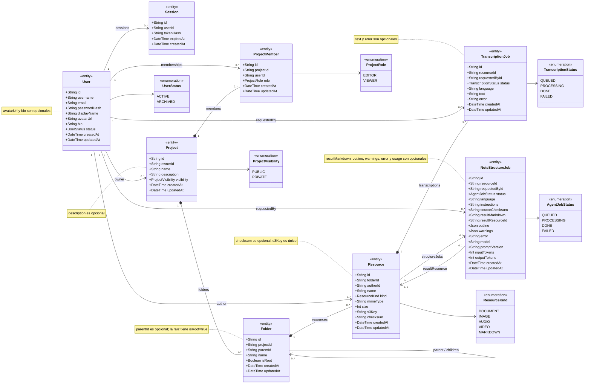
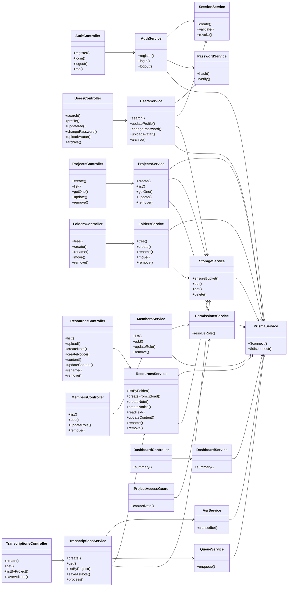
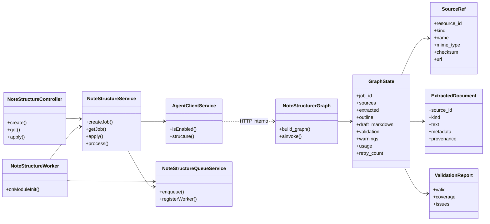

# Diagrama de clases

Dos vistas complementarias:

1. **Modelo de dominio**: entidades y enums de Prisma, con sus relaciones y multiplicidades.
2. **Clases de implementación**: controladores, servicios y dependencias del backend NestJS.

> Las entidades son clases de datos: el comportamiento vive en los servicios. Los atributos marcados como opcionales en Prisma (`String?`) se documentan en las notas de cada clase para no recargar el diagrama.

## 1. Modelo de dominio (Base de datos)

### Reglas del modelo

- `Project.ownerId` es la única fuente del rol **Owner**; el Owner no se guarda en `ProjectMember`.
- `ProjectMember.role` solo admite `EDITOR` o `VIEWER`.
- `Session.tokenHash` guarda el SHA-256 del token, nunca el token en claro.
- `Resource` representa archivos, avisos y apuntes; no existen tablas `Note` ni `Notice`.
- El borrado de `Project`, `Folder`, `Resource` y `Session` es en cascada según Prisma.
- `Folder.parentId` es una auto-relación; la raíz tiene `isRoot = true`.

## 2. Clases de implementación del backend

## 2.5 Clases del servicio de agentes

## 3. Notas de implementación

- Los controladores solo orquestan HTTP y delegación; la lógica vive en los servicios.
- `ProjectAccessGuard` usa `PermissionsService.resolveRole` para resolver el rol efectivo en cada petición.
- `TranscriptionsService` usa `QueueService` para el job asíncrono, `StorageService` para descargar el audio, `AsrService` para llamar a Whisper y `ResourcesService` para guardar el apunte.
- `StorageService` es el único adaptador de MinIO; el resto de módulos no conocen el SDK S3.
- `PrismaService` es compartido por todos los servicios que acceden a PostgreSQL.

## 4. Trazabilidad

| Clase / entidad | Specs |
|---|---|
| `User`, `Session` | 001 |
| `Project`, `Folder` | 002, 003 |
| `Resource` | 004, 005, 006, 009 |
| `ProjectMember` | 007, 008 |
| `TranscriptionJob` | 010 |
| `NoteStructureJob` | 012 |
| `NoteStructureService`, `AgentClientService` | 012 |
| `DashboardService` | 011 |

> El diagrama formal equivalente se crea en Enterprise Architect desde [`docs/sdd/ea/modelo.json`](../ea/modelo.json).
