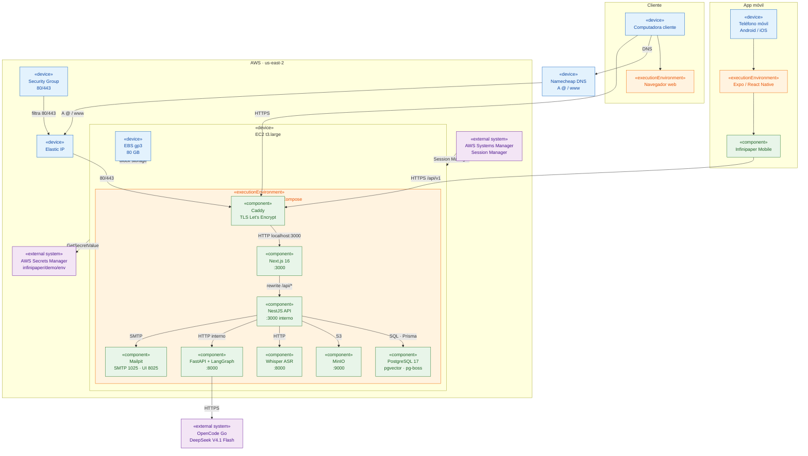

# Diagrama de despliegue

Vista UML del despliegue actual de la demo: una instancia EC2 en `us-east-2` con Docker Compose, publicada mediante Caddy y `infinipaper.lat`, más la app móvil Expo.

> La demo usa una sola instancia y Mailpit. No usa RDS, S3, SES ni un balanceador de AWS; esas piezas se reservan para una versión de producción.

## Diagrama



## Nodos y responsabilidades

| Nodo | Tipo UML | Responsabilidad |
|---|---|---|
| Computadora cliente | `«device»` | Navegador de visitantes y usuarios autenticados |
| Teléfono móvil | `«device»` | App Expo para Android/iOS |
| Namecheap DNS | `«device»` externo | Registros `A` de `@` y `www` hacia la IP elástica |
| EC2 `t3.large` | `«device»` | Host de la demo en `us-east-2` |
| Ubuntu + Docker Compose | `«executionEnvironment»` | Runtime de los contenedores |
| Caddy | `«component»` | Reverse proxy, TLS de Let’s Encrypt y redirección de `www` |
| Next.js 16 | `«component»` | UI web y rewrite same-origin de `/api/*` |
| NestJS API | `«component»` | API `/api/v1`, auth, permisos y jobs |
| PostgreSQL 17 + pgvector | `«component»` | Datos relacionales, búsqueda vectorial y `pg-boss` |
| MinIO | `«component»` | Objetos S3-compatible |
| Whisper ASR | `«component»` | Transcripción de audio |
| FastAPI + LangGraph | `«component»` | Extracción multiformato y generación con IA |
| Mailpit | `«component»` | SMTP de demo para confirmaciones y verificación docente |
| EBS gp3 | `«device»` | Almacenamiento persistente de la instancia |
| Elastic IP | `«device»` | IP pública estable del dominio |
| Security Group | `«device»` | Solo `80/443`; administración por SSM |
| AWS Systems Manager | `«external system»` | Sesiones y comandos sin SSH público |
| AWS Secrets Manager | `«external system»` | `.env` de la demo |
| OpenCode Go | `«external system»` | Modelo `deepseek-v4.1-flash` para los agentes |

## Flujos principales

- **Web:** navegador → Namecheap DNS → Elastic IP → Caddy → Next.js → rewrite `/api/*` → NestJS.
- **Móvil:** Expo → `https://infinipaper.lat/api/v1` → Caddy → Next.js → NestJS. La app usa `X-Mobile-Session`.
- **Archivos:** NestJS → MinIO.
- **Transcripción:** NestJS → Whisper ASR.
- **Generación IA:** NestJS → Agents → OpenCode Go.
- **Correo:** NestJS → Mailpit.
- **Administración:** operador → SSM Session Manager → EC2.
- **Secretos:** EC2 → Secrets Manager al arrancar.

## Decisiones de la demo

- Una sola EC2 con Docker Compose en lugar de ECS, RDS o ALB.
- Caddy termina TLS y publica únicamente `80/443`.
- PostgreSQL y MinIO viven en la misma instancia y persisten en EBS.
- Mailpit sustituye a SES; su UI se consulta por túnel SSM.
- Los agentes usan OpenCode Go con `deepseek-v4.1-flash`.
- No hay SSH público; la administración es por SSM.
- El `.env` se carga desde Secrets Manager y se guarda con permisos `600`.

## App móvil

La app Expo consume la API por el mismo dominio público:

```text
https://infinipaper.lat/api/v1
```

No necesita un subdominio `api.` para la demo: Caddy recibe la petición, Next.js reescribe `/api/*` al backend y el backend valida `X-Mobile-Session`. Si más adelante se quiere separar el tráfico móvil, se puede añadir `api.infinipaper.lat` apuntando a la misma IP y un `reverse_proxy` directo a `backend:3000`.

## Relación con Enterprise Architect

El modelo canónico está en [`../ea/modelo.json`](../ea/modelo.json), dentro de `deployment`. El generador [`../ea/generar.mjs`](../ea/generar.mjs) crea la rama `06 · Despliegue` y el diagrama `Despliegue · AWS EC2 + app móvil` al importar [`../ea/importar-modelo.js`](../ea/importar-modelo.js).
