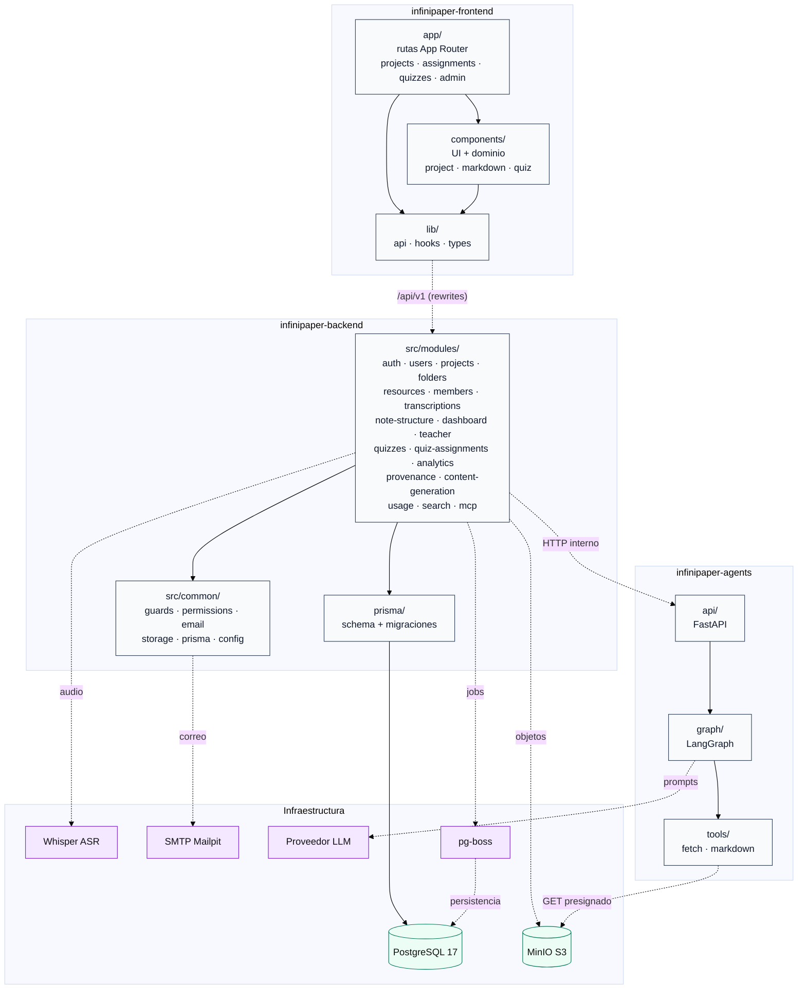

# Diagrama de paquetes

Vista de alto nivel de los paquetes del repositorio y de sus dependencias. Las flechas discontinuas representan dependencias; las continuas, relaciones de uso o composición.

## Responsabilidades

| Paquete | Responsabilidad | Specs |
|---|---|---|
| `app/` | Rutas, layouts, páginas y protección de navegación, panel y progreso | 001–012, 015–022 |
| `components/` | Componentes de UI y dominio (proyecto, markdown, workspace, quiz, mindmap, procedencia) | 002–012, 015–022 |
| `lib/` | Cliente API same-origin, hooks, tipos y utilidades | 001–012, 015–022 |
| `src/modules/` | Módulos NestJS: auth, users, projects, folders, resources, members, transcriptions, note-structure, dashboard, teacher, quizzes, quiz-assignments, analytics, provenance, content-generation, usage, search, mcp | 001–012, 015–025 |
| `src/common/` | Guards, permisos, email/SMTP, storage S3, Prisma, configuración y errores | 001–012, 015–025 |
| `prisma/` | Esquema, migraciones y cliente generado | 001–012, 015–022 |
| `infinipaper-agents/api/` | FastAPI: autenticación y endpoint de estructuración | 012 |
| `infinipaper-agents/graph/` | Grafo LangGraph: router, extractores, structurer y validador | 012 |
| `infinipaper-agents/tools/` | Descarga presignada y utilidades Markdown | 012 |
| Infraestructura | PostgreSQL + pgvector, MinIO, Whisper, Mailpit, proveedor LLM, embeddings, FastMCP y cola `pg-boss` | 005, 009, 010, 012, 015–025 |

## Reglas de dependencia

- `app/` y `components/` **no** acceden directamente a la base de datos ni a MinIO; todo pasa por `/api/v1`.
- `lib/` solo conoce el contrato HTTP; no importa código de backend.
- `src/modules/` depende de `src/common/` y de Prisma; no importa código de frontend.
- `src/modules/` llama a `infinipaper-agents` por HTTP interno autenticado; el frontend nunca habla directamente con los agentes.
- `src/common/email` encapsula SMTP; en desarrollo apunta a Mailpit y en producción a un proveedor real.
- `RolesGuard` y `PermissionsService` centralizan la autorización global y de proyecto.
- `ProjectPurgeQueueService` usa `pg-boss` para purgar proyectos archivados vencidos.
- `AnalyticsService` agrega datos de evaluación solo para Owner/Editor; `my-progress` limita al estudiante.
- `ProvenanceService` gestiona `ResourceSource` y la validación docente.
- `ContentGenerationService` y su cola generan mapas mentales y quizzes IA a través de agentes.
- `UsageService` registra y agrega eventos de uso; `SearchService` indexa chunks y consulta pgvector.
- `McpService` valida tokens y expone datos de solo lectura; FastMCP vive en agentes.
- `infinipaper-agents` no accede a la base de datos ni recibe credenciales S3; usa URLs presignadas.
- `PermissionsService` y `StorageService` son servicios compartidos.
- La infraestructura se consume a través de adaptadores (`PrismaService`, `StorageService`, `AsrService`, `QueueService`).
