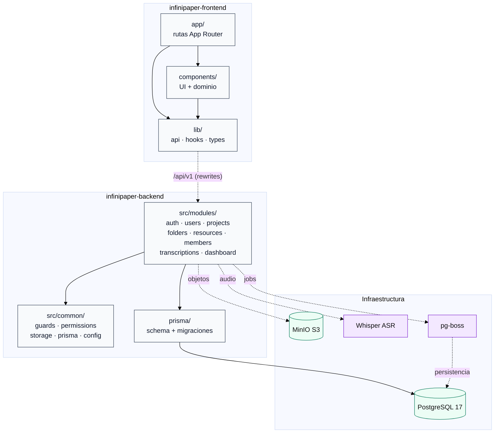

# Diagrama de paquetes

Vista de alto nivel de los paquetes del repositorio y de sus dependencias. Las flechas discontinuas representan dependencias; las continuas, relaciones de uso o composición.

## Responsabilidades

| Paquete | Responsabilidad | Specs |
|---|---|---|
| `app/` | Rutas, layouts, páginas y protección de navegación | 001–011 |
| `components/` | Componentes de UI y dominio (proyecto, markdown, workspace) | 002–011 |
| `lib/` | Cliente API same-origin, hooks, tipos y utilidades | 001–011 |
| `src/modules/` | Módulos NestJS: auth, users, projects, folders, resources, members, transcriptions, dashboard | 001–011 |
| `src/common/` | Guards, permisos, storage S3, Prisma, configuración y errores | 001–011 |
| `prisma/` | Esquema, migraciones y cliente generado | 001–011 |
| Infraestructura | PostgreSQL, MinIO, Whisper y cola `pg-boss` | 005, 009, 010 |

## Reglas de dependencia

- `app/` y `components/` **no** acceden directamente a la base de datos ni a MinIO; todo pasa por `/api/v1`.
- `lib/` solo conoce el contrato HTTP; no importa código de backend.
- `src/modules/` depende de `src/common/` y de Prisma; no importa código de frontend.
- Los módulos no se llaman entre sí de forma circular; `PermissionsService` y `StorageService` son servicios compartidos.
- La infraestructura se consume a través de adaptadores (`PrismaService`, `StorageService`, `AsrService`, `QueueService`).
