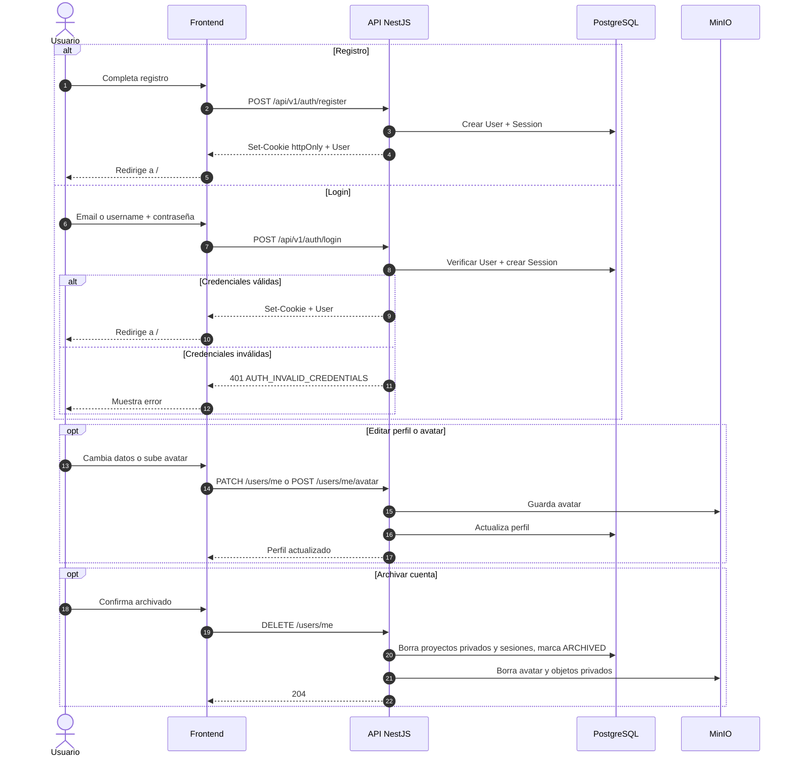

# Secuencia 001 · Usuarios, autenticación y sesiones

> Spec: [001-usuarios](../../specs/001-usuarios/spec.md)

## Notas

- La sesión viaja en cookie `httpOnly`; el frontend nunca lee el token.
- El archivado es lógico y elimina en cascada los proyectos privados.
- El avatar se guarda en MinIO y se sirve por el backend.
