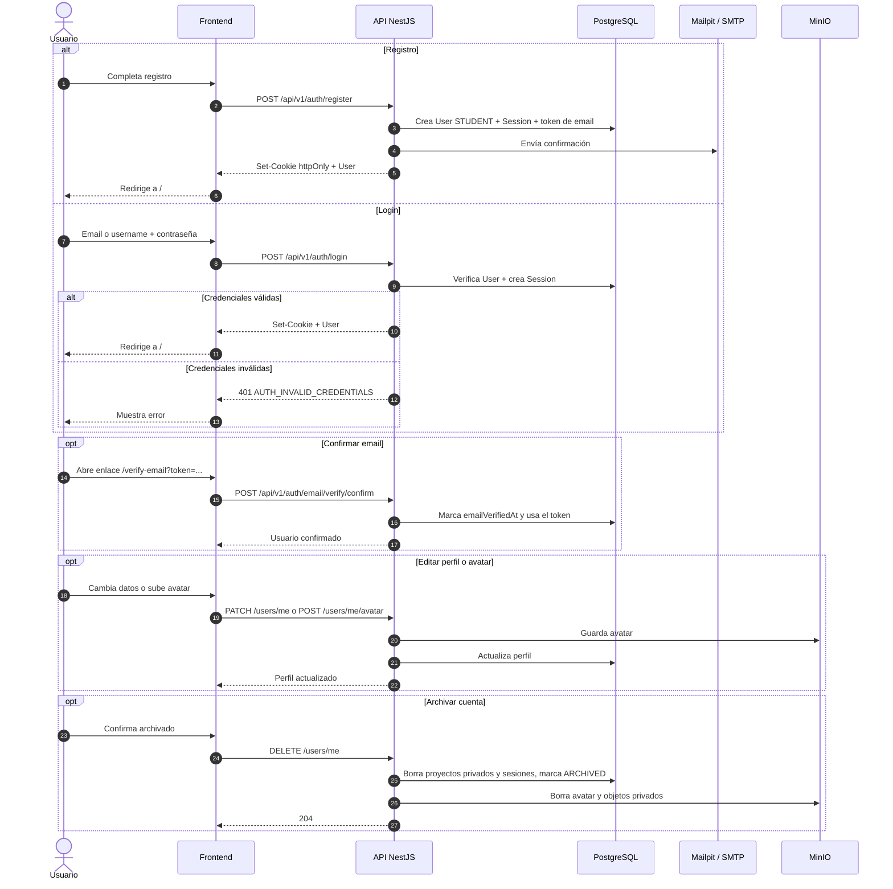

# Secuencia 001 · Usuarios, autenticación y sesiones

> Spec: [001-usuarios](../../specs/001-usuarios/spec.md)

## Notas

- La sesión viaja en cookie `httpOnly`; el frontend nunca lee el token.
- El registro asigna el rol global `STUDENT`; nunca crea un administrador.
- La confirmación de email y el perfil docente se detallan en la spec 015.
- El archivado es lógico: elimina proyectos privados, conserva públicos y no sustituye la revocación docente de 015.
- El avatar se guarda en MinIO y se sirve por el backend.
