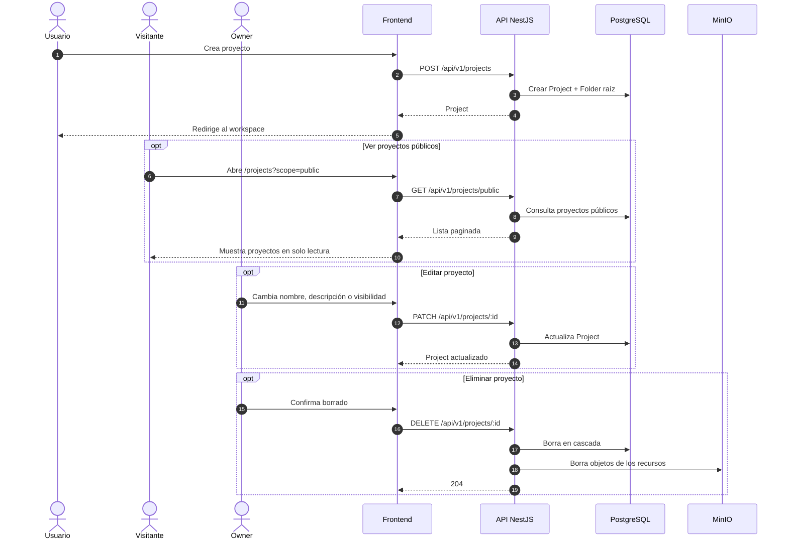

# Secuencia 002 · Proyectos

> Spec: [002-proyectos](../../specs/002-proyectos/spec.md)

## Notas

- La carpeta raíz se crea en la misma operación que el proyecto.
- Solo el Owner edita o elimina; los públicos permiten lectura anónima.
