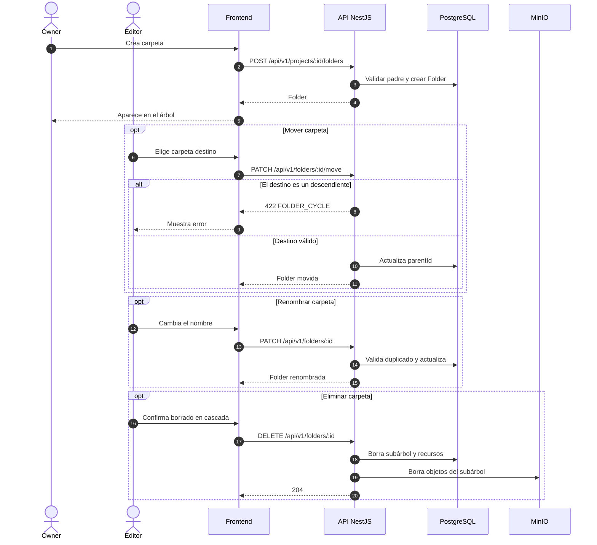

# Secuencia 003 · Carpetas

> Spec: [003-carpetas](../../specs/003-carpetas/spec.md)

## Notas

- La raíz (`isRoot`) no se puede mover ni eliminar.
- Los nombres se comparan sin distinguir mayúsculas en el servicio.
- El borrado es destructivo y limpia S3.
