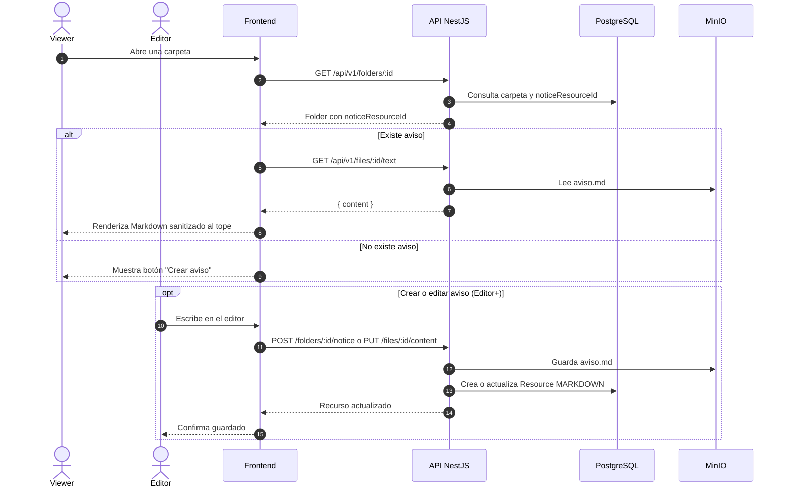

# Secuencia 004 · Aviso en carpeta

> Spec: [004-aviso](../../specs/004-aviso/spec.md)

## Notas

- El aviso es un `Resource` MARKDOWN visible en el listado.
- La detección usa `AVISO_FILENAME` y `noticeResourceId`.
- El render usa `react-markdown` + `rehype-sanitize`.
