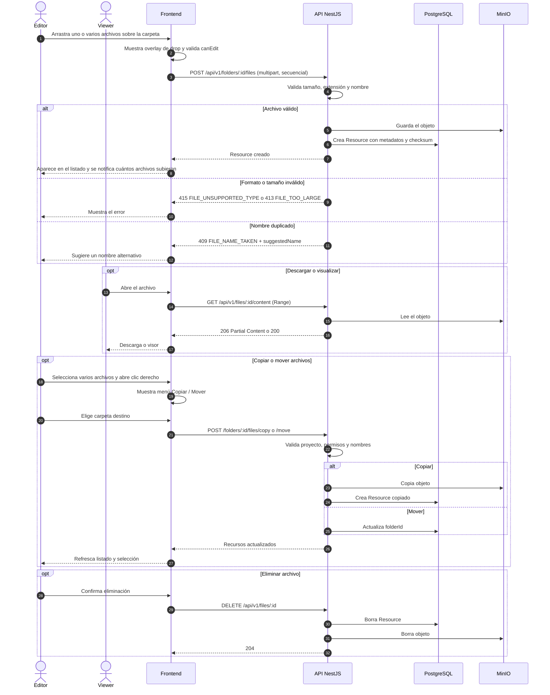

# Secuencia 005 · Gestión de archivos

> Spec: [005-archivos](../../specs/005-archivos/spec.md)

## Notas

- El menú contextual se abre con clic derecho y actúa sobre la selección.
- Copiar duplica el objeto S3; mover solo cambia la carpeta.
- Las copias resuelven colisiones con `(copia)`.
- El drop target solo está activo para Owner/Editor.
- Los archivos se suben secuencialmente para evitar saturar el backend.
- El límite se aplica en el backend con `MAX_UPLOAD_SIZE_MB`.
- El `kind` se deriva de la extensión.
- MinIO nunca se expone al navegador.
