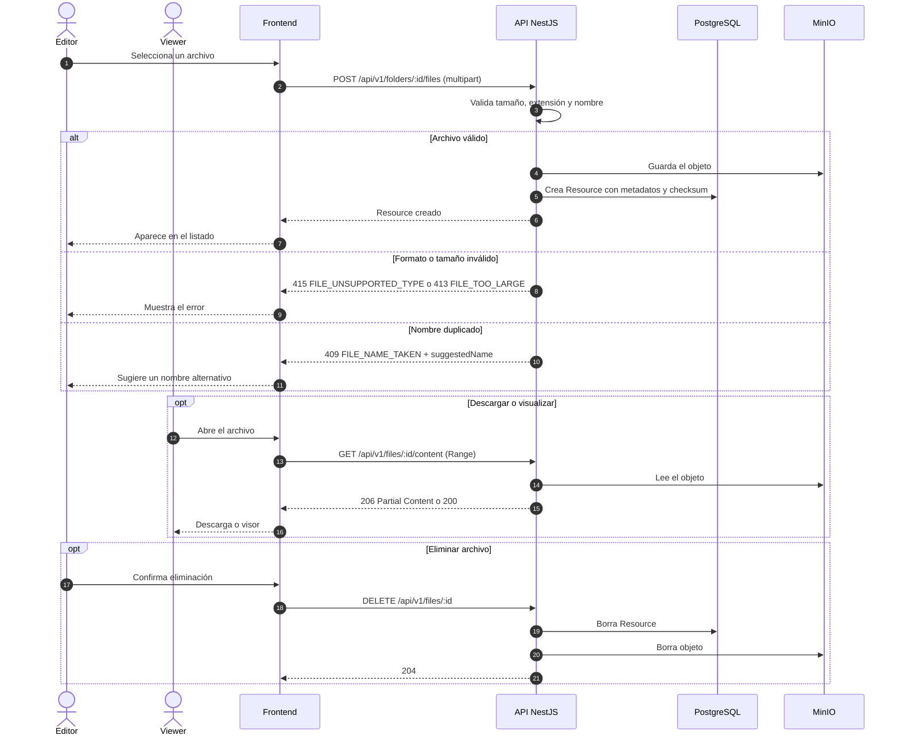

# Secuencia 005 · Gestión de archivos

> Spec: [005-archivos](../../specs/005-archivos/spec.md)

## Notas

- El límite se aplica en el backend con `MAX_UPLOAD_SIZE_MB`.
- El `kind` se deriva de la extensión.
- MinIO nunca se expone al navegador.
