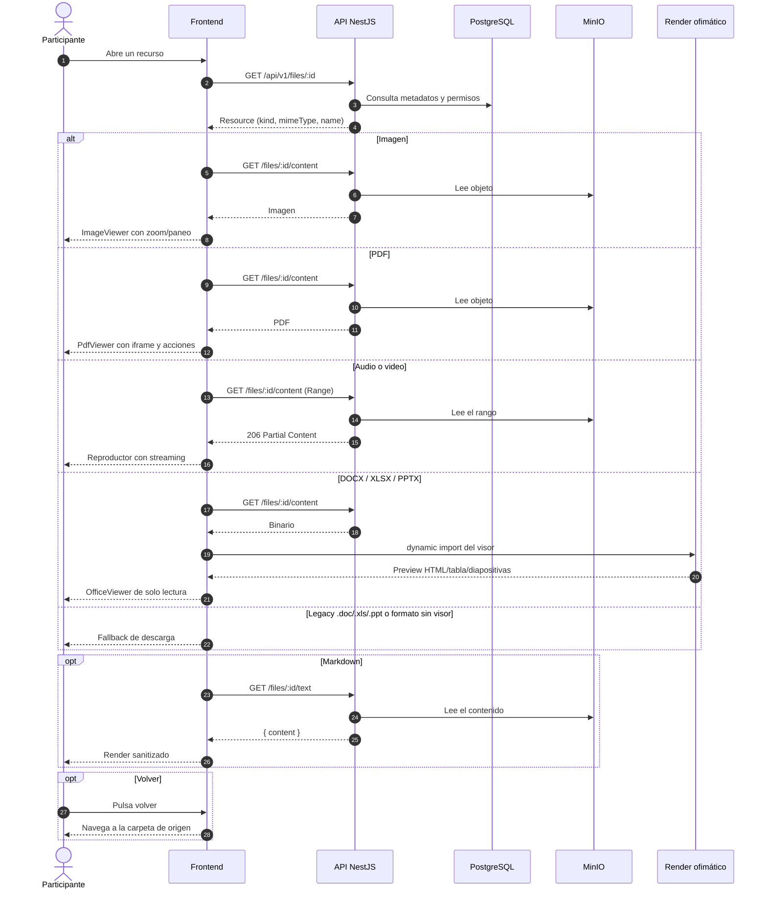

# Secuencia 006 · Visualización multimedia

> Spec: [006-visualizacion](../../specs/006-visualizacion/spec.md)

## Notas

- Todos los visores comparten `ViewerShell` y los tokens Paper & Ink / Midnight Study.
- Las librerías ofimáticas se cargan con `dynamic import` solo cuando hacen falta.
- La fuente binaria en MinIO sigue siendo la fuente de verdad; el render es de solo lectura y desacoplado para una futura capa colaborativa.
- DOCX se renderiza con `docx-preview`, XLSX/CSV/ODS con `xlsx` y PPTX con `pptx-preview`.
- Los formatos legacy y los códecs no soportados tienen fallback de descarga.
- Audio y video usan `Range` para evitar descargar todo el archivo.
