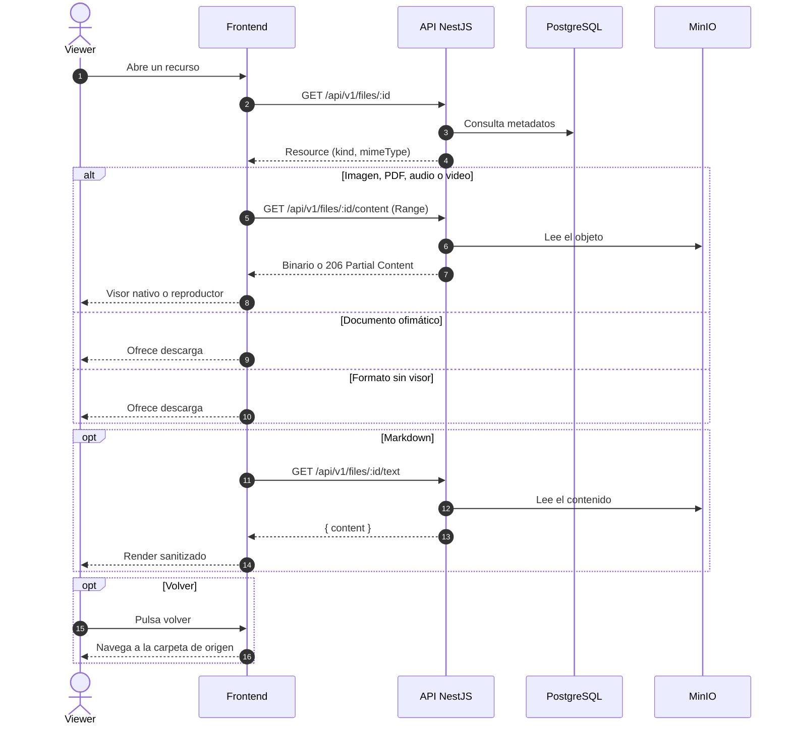

# Secuencia 006 · Visualización multimedia

> Spec: [006-visualizacion](../../specs/006-visualizacion/spec.md)

## Notas

- PDF se muestra con el visor nativo del navegador en un `<iframe>`.
- Audio y video usan `Range` para evitar descargar todo el archivo.
- Los permisos se validan antes de servir el contenido.
