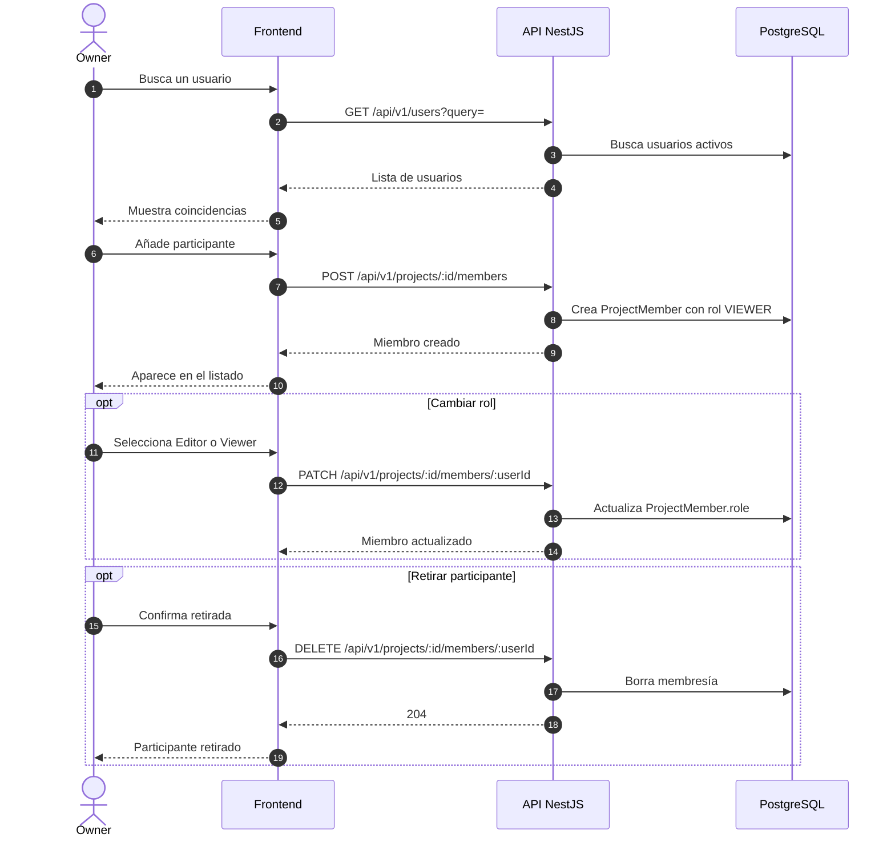

# Secuencia 007 · Participantes

> Spec: [007-participantes](../../specs/007-participantes/spec.md)

## Notas

- Solo el Owner gestiona participantes.
- El alta es directa, sin invitación ni aceptación.
- El Owner no se representa como `ProjectMember` y no puede retirarse por esta vía.
