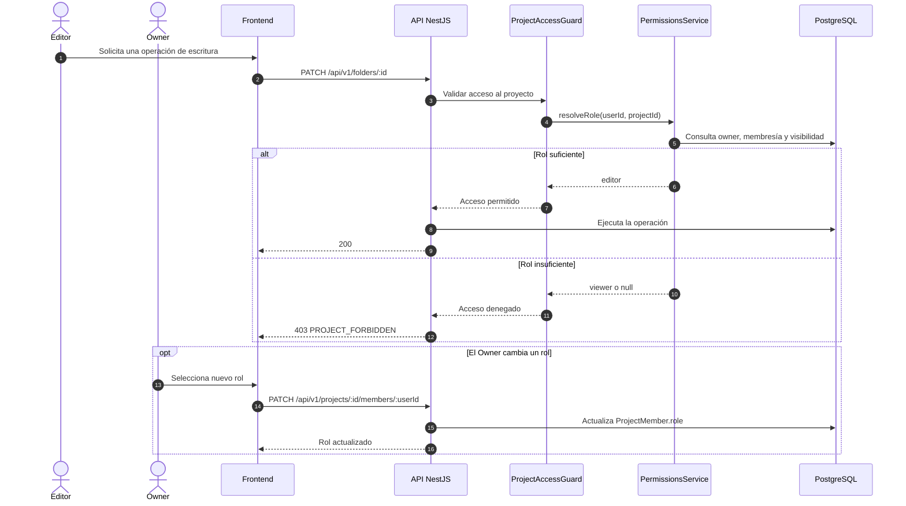

# Secuencia 008 · Permisos y roles

> Spec: [008-permisos](../../specs/008-permisos/spec.md)

## Notas

- La autorización se resuelve en cada petición; no se cachea el rol.
- La jerarquía es `owner > editor > viewer > público (lectura)`.
- La UI oculta acciones, pero el servidor es la fuente de verdad.
