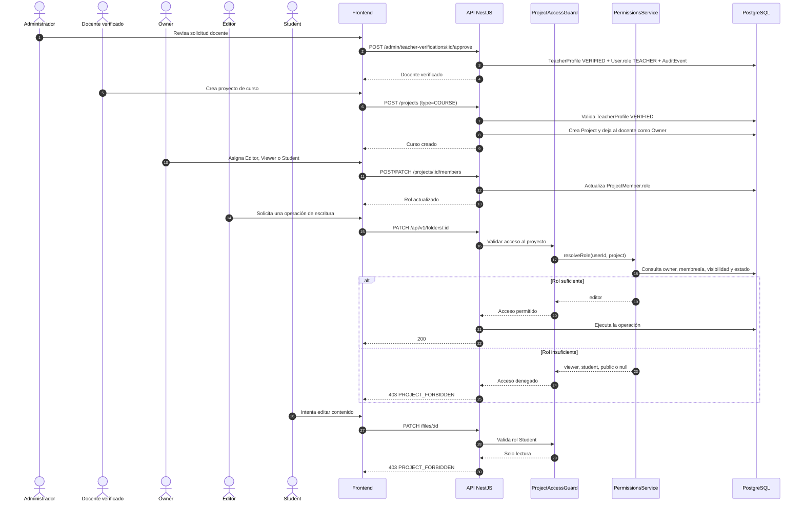

# Secuencia 008 · Permisos y roles

> Spec: [008-permisos](../../specs/008-permisos/spec.md)

## Notas

- La autorización se resuelve en cada petición; no se cachea el rol.
- El rol global no sustituye la membresía del proyecto.
- El `ADMIN` verifica docentes, pero no obtiene acceso implícito al contenido privado.
- Un `TEACHER` verificado puede crear cursos y queda como Owner; en cursos ajenos necesita membresía.
- La jerarquía de contenido es `owner > editor > viewer/student > público (lectura)`.
- La UI oculta acciones, pero el servidor es la fuente de verdad.
