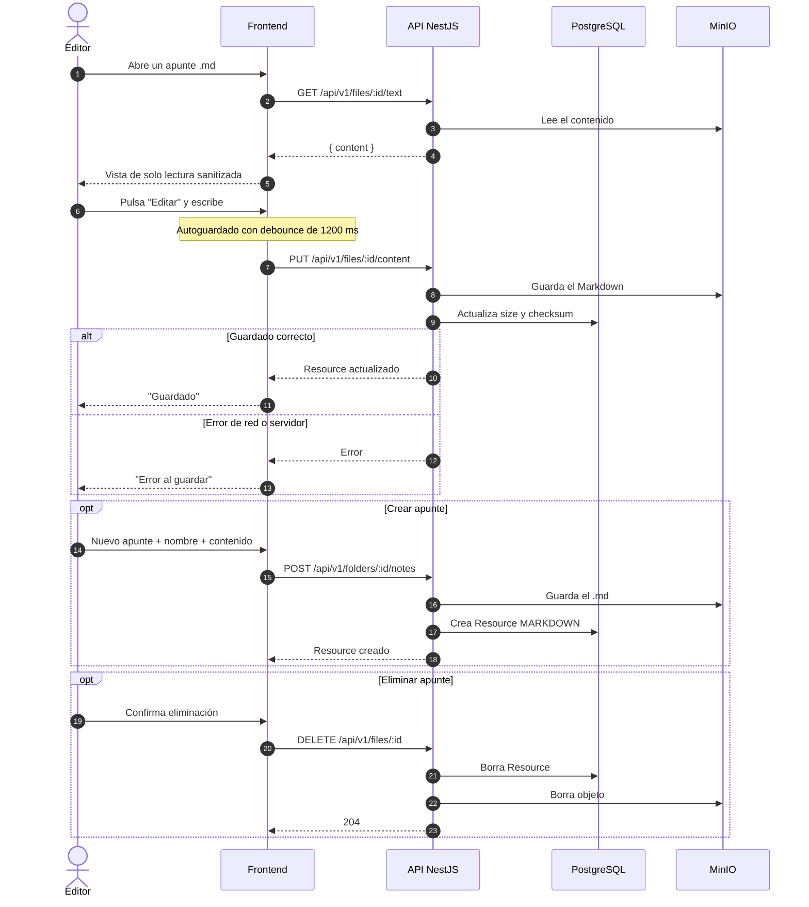

# Secuencia 009 · Apuntes Markdown

> Spec: [009-apuntes](../../specs/009-apuntes/spec.md)

## Notas

- El editor es MDXEditor y se carga de forma diferida.
- La vista de lectura usa `rehype-sanitize`.
- Los conflictos son *last-write-wins*; no hay colaboración en tiempo real.
