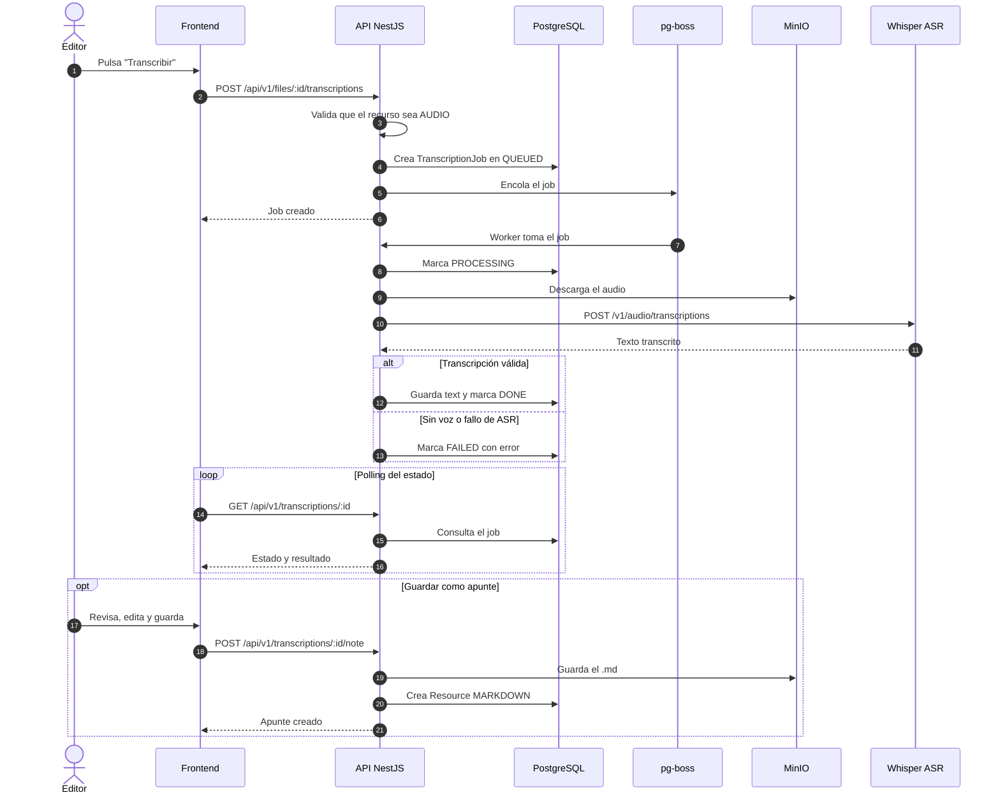

# Secuencia 010 · Transcripción de audio

> Spec: [010-transcripcion](../../specs/010-transcripcion/spec.md)

## Notas

- El trabajo es asíncrono y no bloquea la petición HTTP.
- El frontend consulta el estado por polling.
- El apunte se guarda en la misma carpeta del audio.
