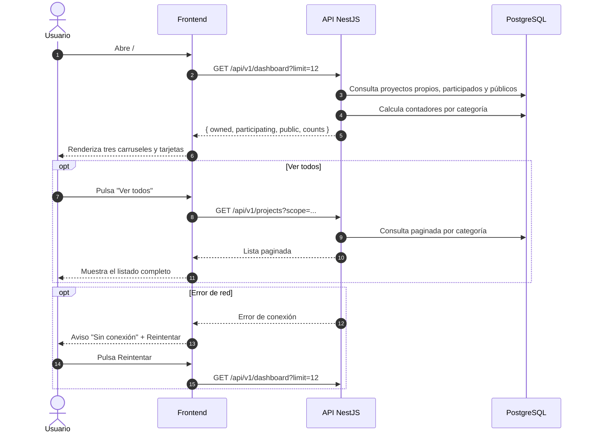

# Secuencia 011 · Dashboard personal

> Spec: [011-dashboard](../../specs/011-dashboard/spec.md)

## Notas

- El dashboard es la vista inicial en `/`.
- Un proyecto aparece en una sola categoría.
- Los públicos son los más recientes de otros usuarios, sin recomendación.
