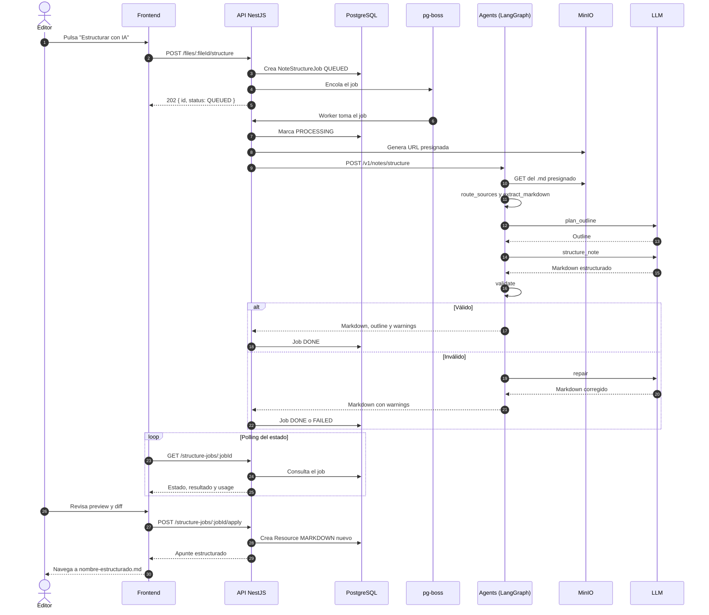

# Secuencia 012 · Estructuración de apuntes con IA

> Spec: [012-estructuracion-apuntes-ia](../../specs/012-estructuracion-apuntes-ia/spec.md)

## Notas

- El servicio de agentes es stateless: no accede a la base de datos ni recibe credenciales S3.
- NestJS conserva el estado del job y aplica los permisos.
- El original nunca se modifica; se crea un nuevo `Resource` MARKDOWN.
- En v1 solo se enrutan fuentes `markdown`; el grafo está preparado para PDF, imagen, audio, video y web.
