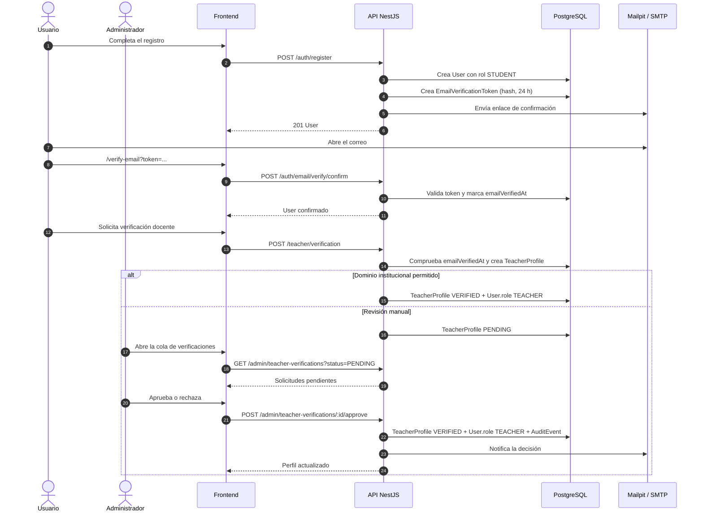

# Secuencia 015 · Perfil docente y confirmación de email

> Spec: [015-perfil-docente](../../specs/015-perfil-docente/spec.md)

## Notas

- El registro no falla si el SMTP no responde; el fallo se registra y el usuario puede reenviar el correo.
- La verificación automática exige que el correo esté confirmado.
- La revocación vuelve el rol global a `STUDENT` y archiva los cursos activos del docente.
- Todas las decisiones administrativas generan un `AuditEvent`.
