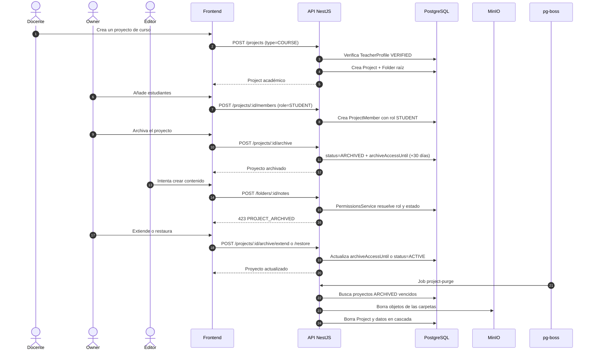

# Secuencia 016 · Proyectos académicos y archivado

> Spec: [016-proyectos-academicos](../../specs/016-proyectos-academicos/spec.md)

## Notas

- El Owner conserva la gestión del proyecto archivado; el resto de participantes queda en solo lectura.
- La purga solo elimina proyectos cuyo `archiveAccessUntil` ya venció.
- Si falla el borrado de algún objeto de MinIO, el proyecto se conserva para reintentar.
- El endpoint `POST /admin/projects/purge-expired` permite una purga manual auditada.
