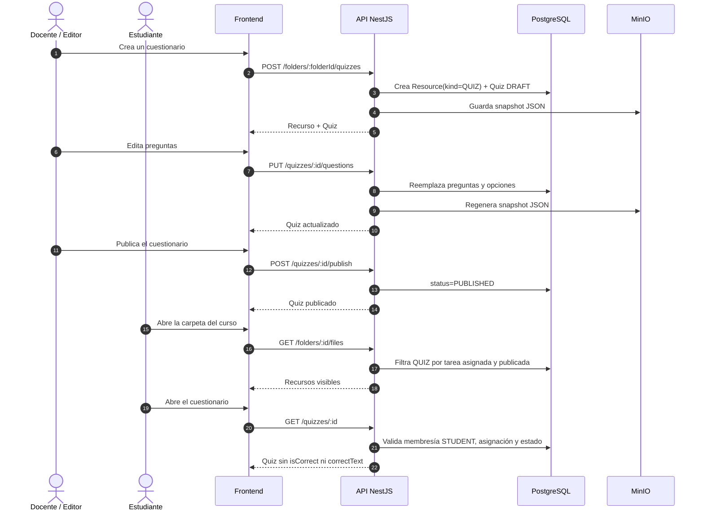

# Secuencia 017 · Cuestionarios como recursos

> Spec: [017-cuestionarios](../../specs/017-cuestionarios/spec.md)

## Notas

- El cuestionario es un `Resource` más: aparece en la jerarquía, se mueve y se lista como los demás.
- Las preguntas viven en tablas relacionales; el JSON de MinIO es un snapshot.
- Un estudiante no asignado no ve el cuestionario en el listado.
- La descarga del snapshot queda bloqueada para estudiantes porque contiene respuestas correctas.
- Un cuestionario con intentos no se puede eliminar físicamente.
