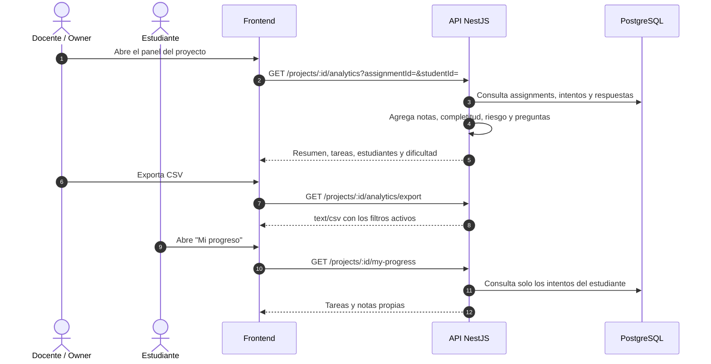

# Secuencia 019 · Panel docente y progreso

> Spec: [019-panel-docente](../../specs/019-panel-docente/spec.md)

## Notas

- El panel general exige Owner/Editor; el estudiante usa su propia vista.
- Se usa el último intento enviado o calificado por tarea y estudiante.
- Las tareas sin intentos se muestran como pendientes sin dividir por cero.
- El umbral de riesgo se configura con `PROJECT_RISK_THRESHOLD`.
