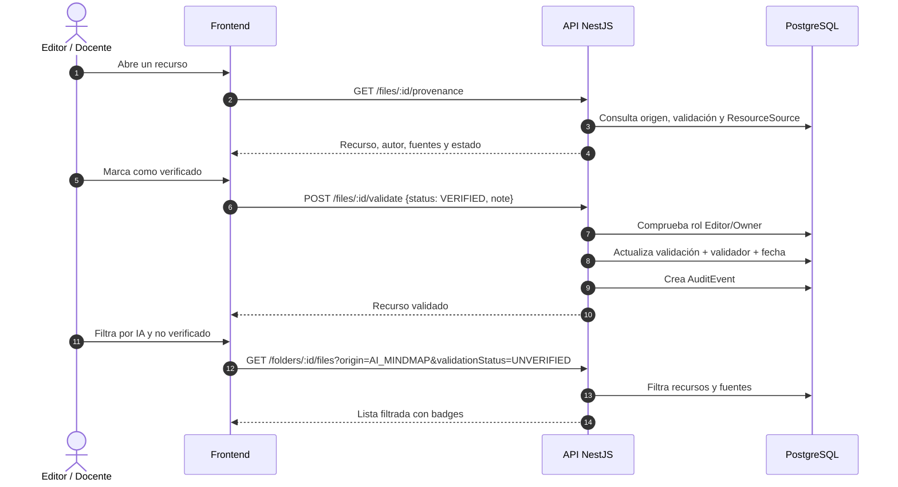

# Secuencia 020 · Trazabilidad y validación

> Spec: [020-trazabilidad-recursos](../../specs/020-trazabilidad-recursos/spec.md)

## Notas

- Los recursos generados por IA nacen `UNVERIFIED`.
- La validación no altera el contenido.
- Un recurso derivado advierte si alguna fuente no está verificada.
- Las fuentes eliminadas se muestran como “fuente eliminada”.
