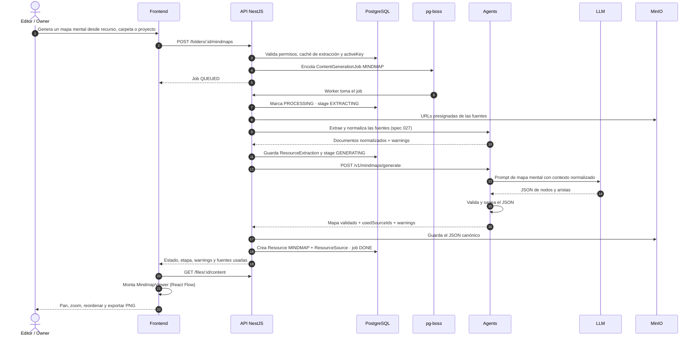

# Secuencia 021 · Mapas mentales con IA

> Spec: [021-mapas-mentales](../../specs/021-mapas-mentales/spec.md)

## Notas

- El original nunca se modifica.
- El mapa nace `UNVERIFIED` y conserva la cadena de fuentes.
- Un job fallido guarda el código de error y admite reintento.
- La generación reutiliza la caché de extracción y la cola de la spec 028.
- El visor interactivo y la exportación PNG se detallan en la spec 029.
- Las posiciones manuales del visor se guardan en `localStorage`, no en el servidor.
