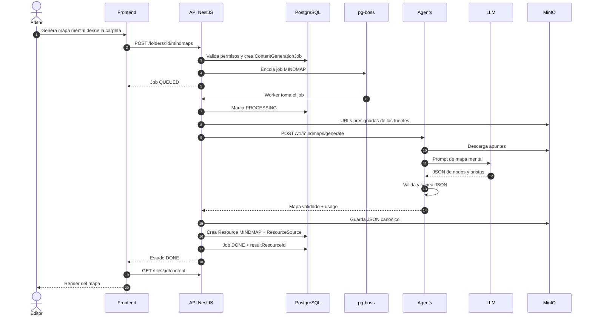

# Secuencia 021 · Mapas mentales con IA

> Spec: [021-mapas-mentales](../../specs/021-mapas-mentales/spec.md)

## Notas

- El original nunca se modifica.
- El mapa nace `UNVERIFIED` y conserva la cadena de fuentes.
- Un job fallido guarda el código de error y admite reintento.
- El visor actual usa un layout radial SVG; la exportación queda para una fase posterior.
