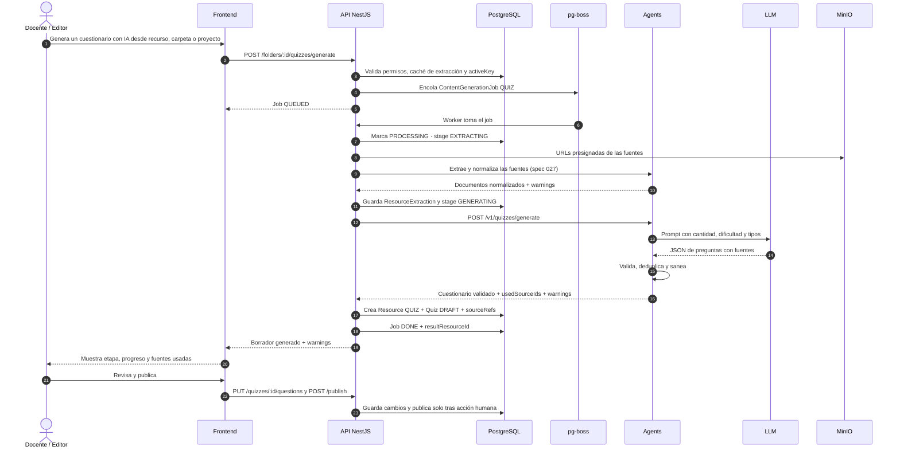

# Secuencia 022 · Cuestionarios con IA

> Spec: [022-cuestionarios-ia](../../specs/022-cuestionarios-ia/spec.md)

## Notas

- El resultado siempre nace `DRAFT` y `UNVERIFIED`.
- Cada pregunta conserva sus `sourceRefs`.
- El estudiante no ve el borrador.
- La generación reutiliza la caché de extracción y la cola de la spec 028.
- PDFs, Word, hojas de cálculo, presentaciones, imágenes, audio y video se admiten mediante la spec 027; los formatos diferidos se omiten con warning.
- Un job duplicado exacto devuelve `GENERATION_JOB_IN_PROGRESS` y no crea otro cuestionario.
