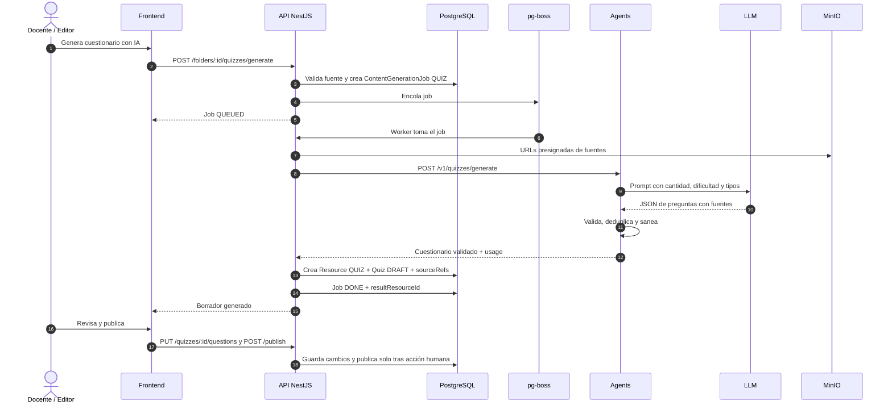

# Secuencia 022 · Cuestionarios con IA

> Spec: [022-cuestionarios-ia](../../specs/022-cuestionarios-ia/spec.md)

## Notas

- El resultado siempre nace `DRAFT` y `UNVERIFIED`.
- Cada pregunta conserva sus `sourceRefs`.
- El estudiante no ve el borrador.
- La generación desde PDFs queda fuera de v1.
