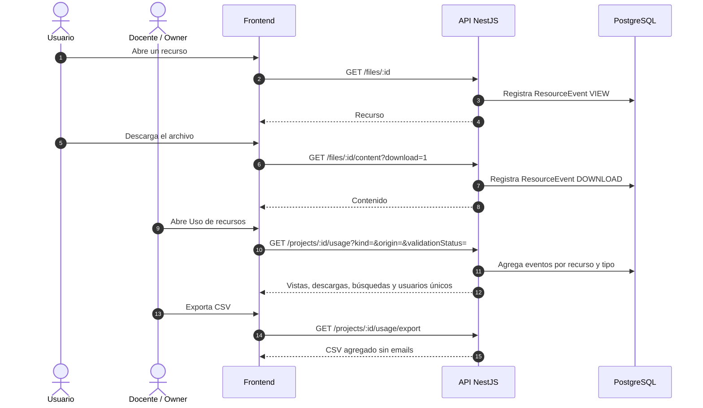

# Secuencia 023 · Métricas de uso de recursos

> Spec: [023-metricas-recursos](../../specs/023-metricas-recursos/spec.md)

## Notas

- Los eventos no guardan contenido.
- Los agregados son por proyecto; nunca globales.
- La retención se configura con `RESOURCE_EVENT_RETENTION_DAYS`.
