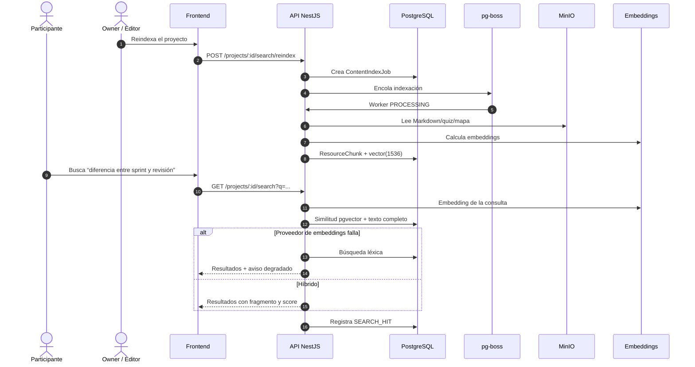

# Secuencia 024 · Búsqueda semántica

> Spec: [024-busqueda-semantica](../../specs/024-busqueda-semantica/spec.md)

## Notas

- Solo se buscan proyectos/carpetas accesibles.
- Los filtros de tipo/origen/validación se aplican en servidor.
- La extensión `vector` y los índices HNSW/GIN viven en PostgreSQL.
