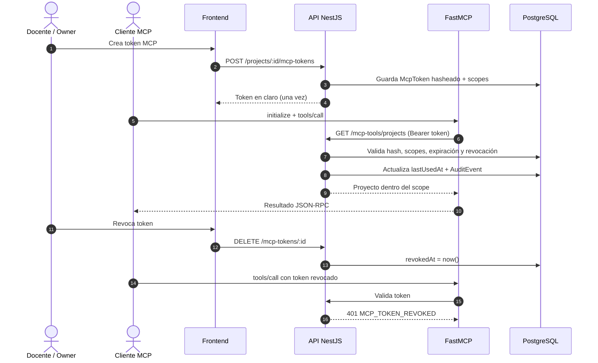

# Secuencia 025 · MCP de desempeño

> Spec: [025-mcp-desempeno](../../specs/025-mcp-desempeno/spec.md)

## Notas

- El MCP es solo lectura y no accede directamente a PostgreSQL.
- Cada token está scoped a un proyecto.
- Rate limit, expiración y auditoría se aplican en el backend.
- Las herramientas disponibles son `list_projects`, `get_project_summary`, `list_quiz_tasks`, `get_task_results` y `get_student_performance`.
