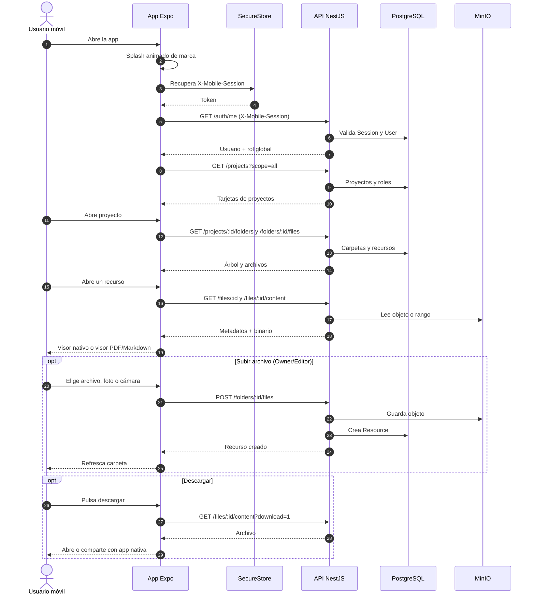

# Secuencia 026 · App móvil

> Spec: [026-app-movil](../../specs/026-app-movil/spec.md)

## Notas

- La sesión móvil usa `X-Mobile-Session`, no la cookie web.
- El servidor sigue siendo la fuente de verdad de permisos y roles.
- Los documentos ofimáticos se abren con la app compatible del dispositivo.
- El splash se anima con la marca del design system.
