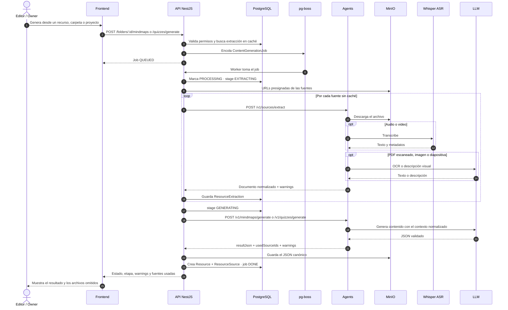

# Secuencia 027 · Fuentes multiformato

> Spec: [027-fuentes-multiformato](../../specs/027-fuentes-multiformato/spec.md)

## Notas

- La caché se reutiliza por `resourceId + checksum + versión del extractor`.
- Si una fuente falla dentro de una carpeta o proyecto, se registra un warning y se continúa.
- Si ninguna fuente produce contenido, el job falla con `EMPTY_SOURCE`.
- La procedencia solo incluye las fuentes que realmente se usaron.
- `AGENT_MULTIFORMAT_ENABLED=false` vuelve al comportamiento Markdown-only.
