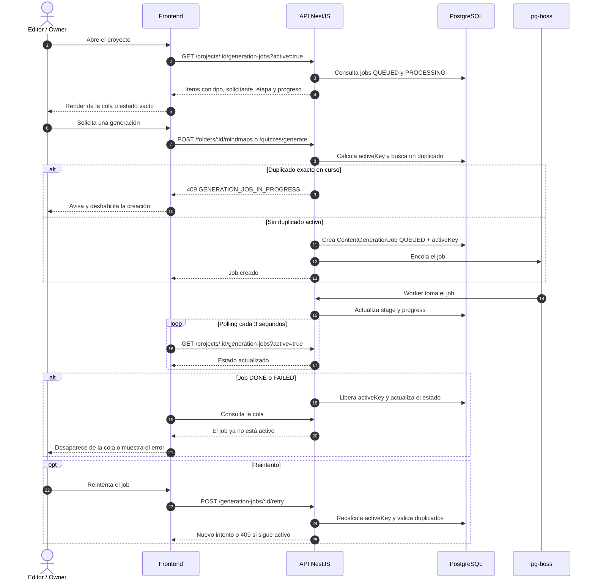

# Secuencia 028 · Cola de generación y duplicados

> Spec: [028-cola-generacion](../../specs/028-cola-generacion/spec.md)

## Notas

- La cola solo muestra jobs activos y está disponible para Owner/Editor.
- Viewer y Student no pueden consultar la cola ni crear jobs.
- El polling se detiene al desmontar el panel o cuando no hay jobs activos.
- `activeKey` es único y se libera al pasar a `DONE` o `FAILED`.
- El panel no bloquea la navegación ni la lista de recursos.
