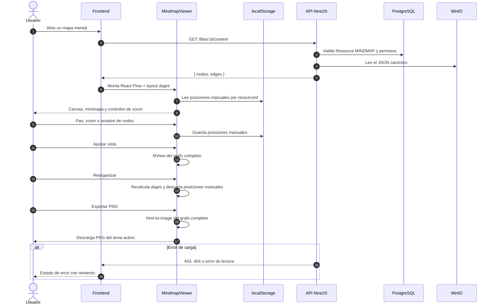

# Secuencia 029 · Visor interactivo de mapas mentales

> Spec: [029-visor-mapas-interactivo](../../specs/029-visor-mapas-interactivo/spec.md)

## Notas

- No hay cambios de API, Prisma ni MinIO: se sigue usando el JSON actual.
- Las posiciones manuales viven en `localStorage` bajo `infinipaper.mindmap.layout.<resourceId>`.
- La exportación incluye todos los nodos y aristas, sin controles ni minimapa.
- El layout automático es determinista para el mismo JSON.
- El canvas se carga solo al abrir un mapa.
