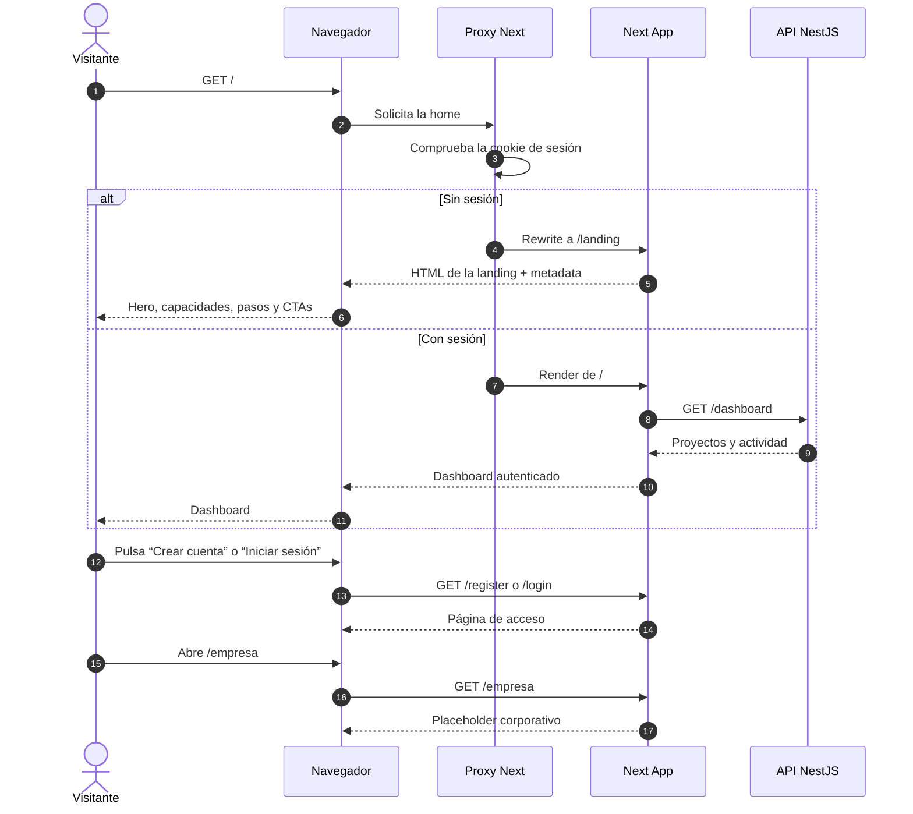

# Secuencia 030 · Landing y sitio corporativo

> Spec: [030-landing-corporativo](../../specs/030-landing-corporativo/spec.md)

## Notas

- La landing y `/empresa` son públicas y no consultan endpoints privados.
- El dashboard en `/` conserva el comportamiento para usuarios autenticados.
- El rewrite de `/` solo aplica a visitantes sin sesión.
- La landing y la página corporativa comparten header, footer, logos y tokens.
- No hay cambios de API, Prisma ni autenticación.
